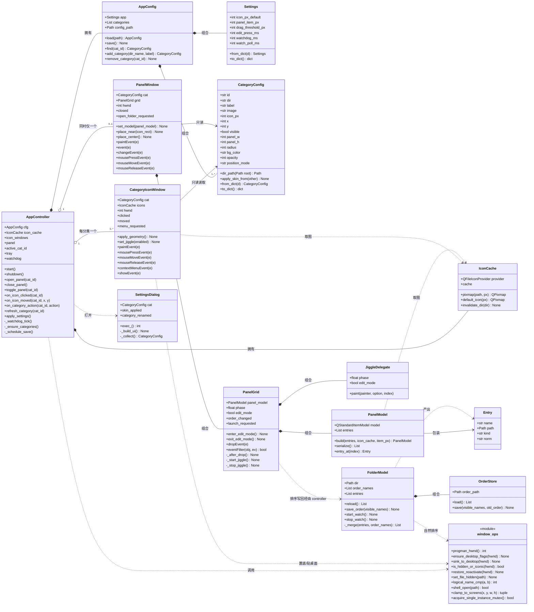
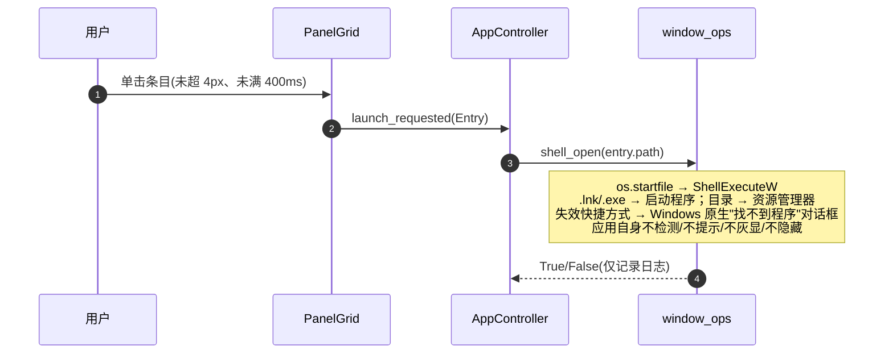
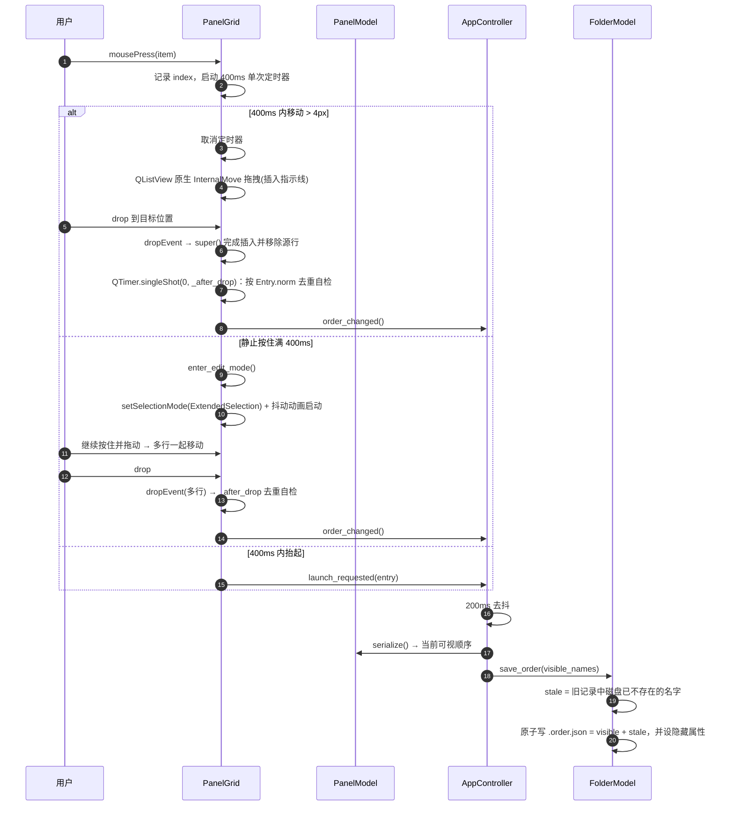
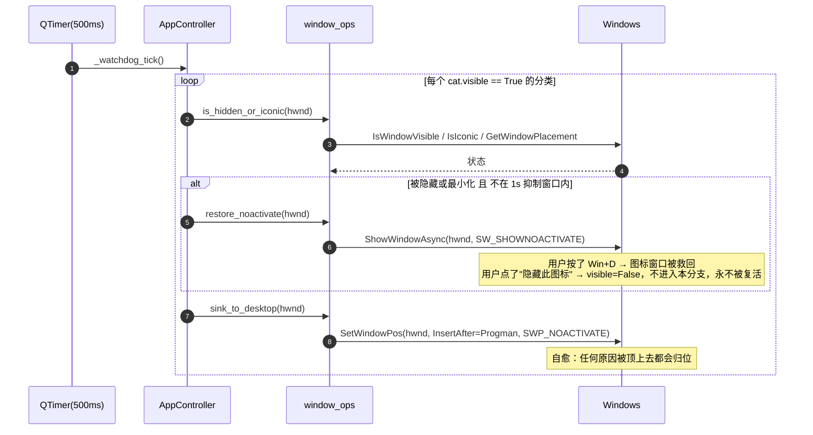
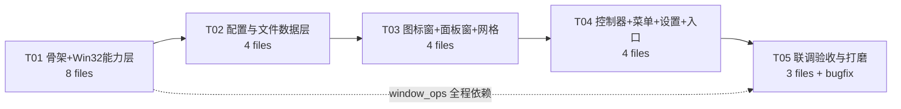

# DesktopBox 系统设计文档

> 版本：v1.0（原设计）+ **v1.2 架构变更见 §10** ｜ 作者：架构师 高见远 ｜ 技术栈：Python 3.13 + PySide6 6.12.0（Qt Widgets）+ ctypes
> 目标：Windows 10/11 桌面图标收纳工具。

> ⚠️ **阅读顺序提示（v1.2）**
>
> 本文 §1–§9 是 v1.0 的原始设计记录，其中**以下部分已被 v1.2 推翻，实现时不要照做**：
>
> | 位置 | v1.0 内容 | v1.2 现状 |
> |---|---|---|
> | §1.3、§2 决策 1、决策 2 | 每分类一个置底悬浮窗 `CategoryIconWindow` | **已删除**（`app/windows/icon_window.py` 不再存在），改为桌面真实 `.lnk` |
> | §2 决策 3 | 500ms 看门狗补偿 Win+D | **已删除**（`Settings.watchdog_ms` 移除），Win+D 问题随方案变更自然消失 |
> | §2 决策 7（桌面图标状态机） | 悬浮窗自身的 4px/400ms 手势 | **已删除**（桌面图标是 `.lnk`，手势由 Windows 负责）；面板内手势状态机**保留不变** |
> | §3 文件清单 #13、#15 | `window_ops` 的 `progman_hwnd` 等 / `icon_window.py` | 相关函数与文件**已删除**；新增 `app/slot_ops.py`、`app/desktop_shortcuts.py`、`app/single_instance.py`、`app/win32/shell_link.py` |
> | §4.1 schema | `app.watchdog_ms`、`cat.x`、`cat.y` | **字段已移除**，旧值静默忽略；`cat.visible` 语义改为"是否保留桌面 .lnk" |
> | §4.3 类图 | `CategoryIconWindow` / `window_ops` 置底族 | 见 §10.4 的新类图增量 |
> | §5.1、§5.4 | 启动流程里的悬浮窗与看门狗 | 见 §10.5 的新启动/唤醒时序 |
> | §9.5 第 6 条 | "不做唤起已有实例的 IPC" | **已推翻**：v1.2 用 `QLocalServer` 实现静默唤醒 |
>
> 面板（`panel_window.py` / `panel_grid.py` / `panel_model.py`）、配置、`.order.json`、
> 图标提取、实时刷新等**其余设计全部继续有效**，v1.2 只做了增量。

---

## 1. 实现方案总述与框架选型

### 1.1 环境实测结论（已在本机验证，工程实现必须以此为准）

| 项 | 实测结果 | 对实现的影响 |
|---|---|---|
| Python | 3.13.14（`desktopbox/.venv`） | 直接用 venv 内解释器 |
| PySide6 | **任务下发时 venv 内并未安装**，仅装了 pip；实测 `pip install PySide6-Essentials` 可成功，得到 **6.12.0**（+ shiboken6 6.12.0） | **T01 第一步必须安装依赖**，`requirements.txt` 固定 `PySide6-Essentials==6.12.0` |
| `QFileIconProvider` 所在模块 | **`PySide6.QtWidgets`**（Qt6 已从 QtGui 迁到 QtWidgets），`QFileInfo` 在 **`PySide6.QtCore`** | 网上大量 Qt5 示例写 `from PySide6.QtGui import QFileIconProvider` 会 ImportError，实现时不要照抄 |
| 图标分辨率 | `QFileIconProvider.icon(exe).pixmap(96,96)` 返回 **256×256**（jumbo 级）；`pixmap(32,32)` 返回 40×40（dpr=1.25 放大） | 图标在 48–128px 下清晰，无需自研 `SHGetFileInfo`；绘制时按目标矩形 `drawPixmap(rect, pm)` 缩放 |
| 已删除/失效路径取图 | `icon(QFileInfo("C:/不存在/foo.lnk"))` 返回 **非空** 通用图标（40×40） | 完美满足需求 10：失效快捷方式照常显示、不灰显、不跳过 |
| 屏幕 | 单屏 1536×864（逻辑坐标），**devicePixelRatio = 1.25**，可用区 1536×824 | 配置里持久化的是 **Qt 逻辑坐标**；恢复位置需 clamp 到可用区 |
| `Progman` 窗口 | `FindWindowW("Progman", None)` → 65974，可获取 | 用"插入到 Progman 之后"实现稳定贴在桌面之上 |
| ctypes | `SetWindowLongPtrW / SetWindowPos / IsIconic / GetWindowPlacement` 均可用，**无需 pywin32** | 全部 Win32 操作走 ctypes |
| `QStandardItemModel.moveRows()` | 恒返回 **False**（模型不支持 moveRows/moveColumns） | 顺序变化**不能**靠 `rowsMoved` 信号检测 |
| `QStandardItemModel.dropMimeData(MoveAction)` | 实测**是复制不是移动**（`[a,b,c,d]` 拖 a→3 得 `[a,b,c,a,d]`） | 必须用 `DragDropMode.InternalMove`（由视图负责删源行），drop 后做去重自检 |
| `QEvent.WindowDeactivate` 派发路径 | **只进 `QWidget.event()`，不进 `changeEvent()`**；`changeEvent()` 只收 `ActivationChange` | 面板"点击外部关闭"必须两处都挂，见 §2 决策 4 |
| `QAbstractItemView.SelectionFlag` | **PySide6 6.12 不存在该枚举**（`hasattr` 为 False），`Select` 标志在 `QItemSelectionModel.SelectionFlag` | 代码选中条目要用 `selectionModel().select(idx, QItemSelectionModel.SelectionFlag.Select)`，否则 `AttributeError`（pythonw 下 traceback 被吞，表现为"长按没反应"） |
| `QStandardItem` 选中 API | `setSelected/isSelected` **不存在** | 模型级选中标记要自定义 `Qt.ItemDataRole.UserRole+N` 承载，再经 `selectionModel` 同步视图级选中 |
| 测试环境：`QT_QPA_PLATFORM` | 一旦在**模块 import 期**（如测试辅助模块里 `os.environ.setdefault("QT_QPA_PLATFORM","offscreen")`）被设为 `offscreen`，**所有真实窗口探针失效**：`winId()`/扩展样式/z-order 全部失真，且失败现象像产品缺陷 | 任何需要真实 `windows` 平台插件的探针，**不得从会改 `os.environ` 的测试辅助模块里借工具函数**；把"不碰 Qt 的配置守卫"与"会初始化的 Qt 辅助"拆成两个模块 |

**扩展样式实测（关键）**：`QWidget(None, FramelessWindowHint|Tool)` + `WA_TranslucentBackground` + `WA_ShowWithoutActivating` 执行 `show()` 后，扩展样式为 `0x00080080`，即 **已含 `WS_EX_TOOLWINDOW`(0x80) 与 `WS_EX_LAYERED`(0x80000)，但不含 `WS_EX_NOACTIVATE`**。追加 `SetWindowLongPtrW(GWL_EXSTYLE, ex|WS_EX_NOACTIVATE)` 后变成 `0x08080080`，再次 `SetWindowPos` 后 **noactivate 仍保持**（不需要每次重设，但窗口被重建后必须重设）。

### 1.2 选型理由

- **Python + PySide6（Qt Widgets）**：环境无 .NET SDK、C# 编译链路被安全策略封禁，Electron 需 Node 且体积/权限成本高；PySide6 已可安装，且自带 `QFileSystemWatcher`、`QSystemTrayIcon`、`QFileIconProvider`、无边框半透明窗口、`QListView` 图标拖拽排序，几乎覆盖全部需求，无需任何第三方运行时依赖。
- **不使用 pywin32 / Pillow**：未安装；`ctypes` 可完成全部 Win32 操作（置底、工具窗、隐藏属性、自然排序、单实例），图标提取用 Qt 内置 provider。**除 PySide6 外零第三方依赖**。
- **架构模式**：MVC 变体 —— `AppConfig / FolderModel / OrderStore` 为模型，`windows/*` 为视图，`AppController` 为唯一控制器与装配点。视图之间**不互相引用**，一律经 controller 转发。
- **不使用 QML**：Widgets 更贴近传统桌面交互（右键菜单、系统托盘、QListView IconMode），且无 .qml 资源文件依赖。

### 1.3 核心设计主张（一句话）

> **每个分类 = 一个独立的无边框小窗口**（不是全屏透明蒙层）；Win32 只做三件事：置底贴桌面、不进任务栏/Alt+Tab、不抢焦点；面板是第二个独立的半透明圆角窗口，靠"失焦关闭"实现点击外部关闭。

---

## 2. 关键技术决策（对 7 个技术问题的结论）

### 决策 1：窗口分层 —— 采用"每分类一个小窗口"，否决全屏大透明窗

**结论：一个分类 = 一个独立的 `CategoryIconWindow`（无边框、透明、尺寸仅覆盖图标+文字区域）。**

理由（逐条对比）：

| 方案 | 点击穿透 | 风险 | 裁决 |
|---|---|---|---|
| A. 一个覆盖全屏的透明窗口 + 按区命中 | 需要 `WS_EX_TRANSPARENT`（整窗穿透，图标就点不到了）或 `WM_NCHITTEST` 返回 `HTTRANSPARENT` 做逐区命中。分层窗口（`WS_EX_LAYERED` + 每像素 alpha）的命中测试由 Windows 按 alpha 判定还是按矩形判定，取决于是否走 `UpdateLayeredWindow`；Qt 走 `SetLayeredWindowAttributes/双缓冲`，**alpha=0 区域仍可能吃掉鼠标**，行为不可靠，需大量实机调试 | **会挡住用户点桌面其他位置、可能吃掉桌面右键** —— 直接违反需求 17 | ❌ 否决 |
| B. 每分类一个小窗口 | **天然不存在穿透问题**：窗口只占图标包围盒，窗口外的一切鼠标事件根本不属于本进程 | 分类图标增多时窗口数增多（实际场景 3–10 个，可忽略）；两个图标重叠时按 z-order 自然叠放 | ✅ **采用** |

**拖动时移动什么？移动窗口本身。** 因为"一个图标就是一个窗口"，窗口位置即图标位置：`mouseMove` 中 `self.move(self.pos() + delta)`，松手时把 `self.x(), self.y()` 写回配置。不需要画布内部坐标系，也不需要重绘整层。

窗口几何（唯一公式，`icon_window.py` 内实现）：

```
pad       = 6
icon_px   = 分类配置 icon_px（48–128，默认 64）
text_h    = 22
width     = clamp(max(icon_px + 2*pad, text_advance(label) + 12), icon_px + 2*pad, 240)
height    = icon_px + text_h + 2*pad
```

图标中心点坐标 `(x + width/2, y + pad + icon_px/2)` 用于面板锚定计算。

### 决策 2：置底与"三不"（不进任务栏 / 不被 Alt+Tab / 不抢焦点）

统一封装在 `app/win32/window_ops.py`，图标窗口 `show()` 之后立即调用：

```python
# 1) 窗口标志（Qt 层）
Qt.FramelessWindowHint | Qt.Tool
win.setAttribute(Qt.WA_TranslucentBackground)     # 圆角/非矩形
win.setAttribute(Qt.WA_ShowWithoutActivating)     # show() 不抢焦点
# 2) 扩展样式（ctypes 层）——实测 Qt.Tool 已带 WS_EX_TOOLWINDOW，仍显式补齐
ex = GetWindowLongPtrW(hwnd, GWL_EXSTYLE)
SetWindowLongPtrW(hwnd, GWL_EXSTYLE, ex | WS_EX_TOOLWINDOW | WS_EX_NOACTIVATE)
# 3) 贴在桌面之上、其他窗口之下：插入到 Progman 之后
SetWindowPos(hwnd, progman_hwnd(), 0,0,0,0,
             SWP_NOMOVE|SWP_NOSIZE|SWP_NOACTIVATE|SWP_NOOWNERZORDER)
```

- `WS_EX_TOOLWINDOW` → **不进任务栏**；`Qt.Tool` 类型本身也不会出现在 **Alt+Tab** 列表（Alt+Tab 只枚举 `WS_EX_APPWINDOW`/无 owner 的顶层窗口）。
- `WS_EX_NOACTIVATE` → 点击图标**不会**激活窗口、不抢当前应用的焦点（用户正在浏览器打字，点一下分类图标，焦点仍在浏览器）。
- **为什么用"插入到 Progman 之后"而不是 `HWND_BOTTOM`**：`HWND_BOTTOM` 会把窗口压到最底层，`Win+D` 时桌面窗口被提到前台，图标可能被 Progman 盖住而"看不见但仍然 IsWindowVisible"。把 `hWndInsertAfter` 设为 `Progman` 的 HWND，语义正好是"桌面之上、所有普通窗口之下"，是最稳的位置。实测 `SetWindowPos` 调用成功（返回值 1）。Progman 取不到时降级为 `HWND_BOTTOM`。
- **防止 Qt 在鼠标按下时把窗口 raise**：`WS_EX_NOACTIVATE` 窗口不激活，Qt 不会走激活-raise 路径；同时 `AppController` 的 500ms 看门狗每轮再调一次 `sink_to_desktop()` 做**自愈**（任何原因被顶上去都会在 0.5s 内归位），无需 `WM_WINDOWPOSCHANGING` 子类化，代码量最小。
- **窗口重建后必须重设**：`EXSTYLE` 在 `setParent`/`setWindowFlags`/`recreate` 后会丢。统一在 `CategoryIconWindow.showEvent()` 里再调一次 `ensure_desktop_flags(hwnd)`（幂等）。
- **多窗口 z 序不变式（可测形式，测试/探针必须按此断言）**：设 z 链自上而下为 `c[0..n]`，`P = Progman`，`W` 为任一分类图标窗口，则只要求：
  1. `index(W) < index(P)` —— **每个**图标都在桌面之上；
  2. 对 `c[index(W)+1:]` 中的每个窗口 `B`，`B` 必须是以下之一，否则即违规：
     - 桌面类窗口（`Progman` / `WorkerW` / `Shell_TrayWnd` / `Shell_SecondaryTrayWnd` / `SHELLDLL_DefView`）；
     - **同进程的兄弟图标窗口**：`GetWindowThreadProcessId(B) == GetCurrentProcessId()` **且** `B` 的扩展样式同时含 `WS_EX_NOACTIVATE` 与 `WS_EX_TOOLWINDOW`；
     - 不可见窗口（`IsWindowVisible(B) == False`）。
  3. **不存在"图标之间的全序"要求** —— 图标彼此的层叠顺序由操作时序决定，不是设计约束。任何断言"A 图标必在 B 图标之上"的测试都是错的，N≥2 个图标时**必然只有最底部那一个**能通过"下方仅桌面类窗口"的字面检查。
  > 豁免范围要**精确**：只豁免"兄弟图标窗口"，绝不能豁免"同进程所有窗口"。面板窗口有 `WS_EX_TOOLWINDOW` 但**没有** `WS_EX_NOACTIVATE`，因此不在豁免内 —— 否则"面板被图标压在下面"这种真 bug 会被探针掩盖。面板与图标的关系是另一条独立断言：面板带 `WindowStaysOnTopHint`，应始终在所有图标之上。
  > z 序断言天然对时序敏感（看门狗逐个重贴图标会瞬时改变兄弟间相对次序），建议采样前静置 ≥ 2 个看门狗周期（≥1.1s），并在 200ms 间隔内连采两次、两次都通过才算 PASS。

### 决策 3：Win+D 补偿 —— 500ms 轮询 + 显式用户意图标志

`Win+D`（显示桌面）会最小化所有顶层可见窗口，包括 `WS_EX_TOOLWINDOW` 窗口。Qt 收不到该事件，用看门狗：

```
QTimer 500ms → AppController._watchdog_tick():
    for cat in cfg.categories where cat.visible:
        hwnd = icon_window(cat).hwnd
        if window_ops.is_hidden_or_iconic(hwnd) and not _suppress_restore_until(cat):
            window_ops.restore_noactivate(hwnd)      # ShowWindowAsync(SW_SHOWNOACTIVATE)
        window_ops.sink_to_desktop(hwnd)             # 自愈式置底
```

- `is_hidden_or_iconic(hwnd)` = `not IsWindowVisible(hwnd) or IsIconic(hwnd) or GetWindowPlacement().showCmd == SW_SHOWMINIMIZED`（三者取或，覆盖 Win+D 的两种表现）。
- **如何不与"用户主动隐藏"冲突**：用户点"隐藏此图标"时，代码**先**把 `cat.visible = False` 落盘，再隐藏窗口。看门狗只救 `visible == True` 的窗口 → 用户主动隐藏永远不会被复活。**判据是配置里的用户意图，而不是窗口状态**，这是不冲突的根本原因。
- 程序内部临时隐藏（设置变更重建窗口、切换图标图片）时，写 `self._suppress_restore_until[t] = time.monotonic() + 1.0`，1 秒内不救，避免"刚隐藏就被拉起"的抖动。
- 复活后立刻 `sink_to_desktop()`，因为 Win+D 会打乱 z-order。
- 副作用处理：Win+D 时面板会因失焦自动关闭（决策 4），符合直觉。

### 决策 4：面板半透明圆角 —— 只用"填充 alpha"，绝不用窗口透明度

> **皮肤按分类独立**：`radius / bg_color / opacity / position_mode` 全部取自 `CategoryConfig`（`cat.*`），不是 `Settings`。`PanelWindow` 只依赖 `cat`，不读 `cfg.app` 的任何外观字段。

```python
# PanelWindow（顶层）
flags = Qt.FramelessWindowHint | Qt.Tool | Qt.WindowStaysOnTopHint
setAttribute(Qt.WA_TranslucentBackground)      # 窗口像素可含 alpha，无黑底

# PanelWindow.paintEvent
r = self.cat.radius                             # 该分类的圆角，0–24
path = QPainterPath()
path.addRoundedRect(QRectF(self.rect()).adjusted(0.5, 0.5, -0.5, -0.5), r, r)
p = QPainter(self)
p.setRenderHint(QPainter.Antialiasing, True)
bg = QColor(self.cat.bg_color)                  # 该分类的背景色 "#RRGGBB"
bg.setAlpha(round(self.cat.opacity / 100 * 255))# 该分类的透明度 0–100 → 0–255
p.fillPath(path, bg)
```

- **透明度 0 时只剩内容**：`opacity=0` ⇒ 填充 alpha=0 ⇒ `paintEvent` 什么都没画出来，而图标/文字/按钮是**子控件自己画的**，不受影响。这正是需求 13 的语义。
- **严禁** `setWindowOpacity()` 或 `QGraphicsOpacityEffect`：那会把子控件内容一起淡出（透明度 0 时整块面板消失），且与圆角裁剪叠加出黑边。
- **圆角不被内容破图**：`PanelWindow` 的布局给内容区留 `margin = max(2, r>0 ? 6 : 2)`；`PanelGrid` 及其 viewport 设为背景透明（`setStyleSheet("background: transparent")`、`setFrameShape(NoFrame)`、`viewport().setAutoFillBackground(False)`），只画图标和文字，不铺不透明底色 → 四角天然干净，无需 `setMask()`（mask 是 1bit，会出现锯齿）。
- **面板尺寸可拉伸（需求 11）**：无边框窗口自己实现边缘拉伸 —— `mousePressEvent` 用 6px 边缘带判定方向（N/S/W/E/四角），`setCursor` 切换 `SizeVerCursor/SizeHorCursor/SizeFDiagCursor/SizeBDiagCursor`，`mouseMove` 中 `setGeometry`；最小 240×160；`mouseRelease` 时把 `panel_w/panel_h` 写回该分类配置。不用 `QSizeGrip`，因为右下角要留给"打开此文件夹"入口（需求 15）。
- **点击面板外关闭（需求 4）**：面板是**会激活的**窗口（不加 NOACTIVATE），覆盖所有情况：点到别的应用、点到桌面（Progman 获得激活）、点到任务栏。
  **⚠️ 事件路由实测修正（本节初版写错过，勿再按"changeEvent 监听 WindowDeactivate"实现）**：`QEvent.WindowDeactivate` **只派发到 `QWidget.event()`，不会进 `changeEvent()`**；`changeEvent()` 只能收到 `ActivationChange`（实测：`sendEvent(WindowDeactivate)` 只触发 `event()`；`sendEvent(ActivationChange)` 只触发 `changeEvent()`）。因此两处都要挂：

  ```python
  def event(self, ev):                      # WindowDeactivate 只走这里
      if ev.type() == QEvent.Type.WindowDeactivate:
          QTimer.singleShot(CLOSE_DELAY_MS, self._check_deactivate)
      return super().event(ev)

  def changeEvent(self, ev):                # 只用来兜住 ActivationChange
      super().changeEvent(ev)
      if ev.type() == QEvent.Type.ActivationChange and not self.isActiveWindow():
          QTimer.singleShot(CLOSE_DELAY_MS, self._check_deactivate)

  def _check_deactivate(self):              # 延迟复核，避免误关
      if self.isVisible() and QApplication.activeWindow() is not self:
          self.close()
  ```

  `CLOSE_DELAY_MS = 120`。只挂在 `changeEvent` 上的后果是"点面板外完全不关"，直接违反需求 4。
  点击**另一个分类图标**时因为图标窗口是 NOACTIVATE 不会产生失焦事件，由 controller 显式处理（`open_panel` 先 `close_panel()`，同分类则 toggle）。
- 已知微小取舍：`opacity` 很小时圆角外的 4 个"空白角"仍属于面板窗口的矩形区域，点击那里不会穿透到桌面。视觉上无感、不影响需求，v1 不处理（可选优化见 §9）。
- 面板打开时会短暂抢焦点（这是"能接收键盘 Esc 关闭、能失焦关闭"的前提），关闭后焦点还给原窗口（`WA_ShowWithoutActivating` 不用在面板上；面板关闭后由系统把焦点还给上一个窗口）。

### 决策 5：图标提取 —— QFileIconProvider + 三元组缓存

```python
# app/icon_provider.py
class IconCache:
    def __init__(self): self._provider = QFileIconProvider()   # 复用单例，构造 expensive
    def pixmap(self, path: Path, px: int) -> QPixmap:
        key = (os.path.normcase(str(path)), self._mtime_ns(path), px)
        if key in self._cache: return self._cache[key]
        icon = self._provider.icon(QFileInfo(str(path)))       # .lnk/.exe/目录 自动识别
        pm = icon.pixmap(QSize(px, px))                        # 实测可返回 256 级高清图
        if pm.isNull(): pm = self.default_icon(px)             # 取不到 → 系统默认图标
        self._cache[key] = pm; return pm
```

- **取图方式**：对任意路径统一用 `provider.icon(QFileInfo(path))`。Qt 的 Windows 实现内部走 `SHGetFileInfo` + `SHGetImageList`：
  - `.exe` → 可执行文件图标；
  - `.lnk` → **解析出目标的图标**（含快捷方式小箭头），目标不存在时返回通用快捷方式图标（**实测非空**）；
  - 目录 → 文件夹图标；
  - 其他类型 → 默认文件图标。
- **绝不做存在性检测**（需求 10）：不 `Path.exists()` 检查目标、不灰显、不加锁标记、不过滤。取不到就 `default_icon`。
- **缓存策略**：key = `(normcase(绝对路径), st_mtime_ns, 目标像素)`；容量上限 512，超出按插入顺序 FIFO 淘汰；分类面板每次 `reload()` 后调用 `IconCache.invalidate_dir(dir)` 清掉该目录前缀的条目（文件被替换但 mtime 恰好相同的情形兜底）。必须在 GUI 线程调用（QPixmap 非线程安全）。
- **内置默认分类图标**：**用 QPainter 代码绘制**（圆角矩形 + 收纳箱轮廓），不引入 png 资源文件，保证将来打包成单文件 exe 时无需外部资源、也不依赖 Pillow。
- 图标尺寸：`px = cat.icon_px`（48–128）；面板内条目固定用 48（常量 `PANEL_ITEM_PX`）。

### 决策 6：排序数据模型（`.order.json`）

**文件位置**：`%USERPROFILE%\DesktopBox\<分类名>\.order.json`，创建后立即 `SetFileAttributesW(path, FILE_ATTRIBUTE_HIDDEN)` 设为隐藏（Windows 不以 `.` 前缀隐藏文件，必须设属性）。

**Schema（v1）**

```json
{
  "version": 1,
  "updated": "2026-11-12T13:41:00Z",
  "order": ["微信.lnk", "开发工具", "QQ.exe", "已经删掉的老条目.lnk"]
}
```

- `order` 是**不重复的文件名字符串数组**（真实文件名，用于 `os.startfile`）；
- 允许包含**磁盘上已不存在的名字**（需求 9：记录保留、但不显示）；
- 结构尽量扁平，只存顺序，其余一切以文件系统为准。

**合并算法（`FolderModel.reload()`，每次刷新都跑，纯函数、可单测）**

```
entries   = [e for e in scandir(dir)              # 只收三类：is_dir → "dir"；
             if e.is_dir() or suffix in {".lnk", ".exe"}]
             # 显式排除 .order.json 与所有其他扩展名（需求 6 只混排这三类）
             # 另排除带 Windows 隐藏属性（st_file_attributes & 0x2）的文件与目录
norm(name) = name.casefold()                      # 大小写不敏感匹配（Windows 语义）
by_norm    = {norm(e.name): e}                    # 同目录不会真重名，仅作防御性去重

result, used = [], set()
for n in order_names:                             # 第一段：按记录顺序
    k = norm(n)
    if k in by_norm and k not in used:
        result.append(by_norm[k]); used.add(k)
    # 记录里有、磁盘上没有 → 静默跳过（不显示，记录保留）
rest = [e for e in entries if norm(e.name) not in used]
rest.sort(key=cmp_to_key(window_ops.logical_name_cmp))   # StrCmpLogicalW，与资源管理器一致
return result + rest                              # 第二段：未记录的新条目按名称排在末尾
```

- **大小写 / 重名**：匹配一律 `casefold()`；同一目录 Windows 本身不允许重名（含仅大小写不同），故 `by_norm` 不可能真冲突；万一冲突，**先出现者胜**，后者进入第二段按名称排序。
- **`.order.json` 被误删/损坏**：`load()` 捕获 `FileNotFoundError / JSONDecodeError / KeyError / TypeError`，一律返回 `[]` → 退化为"全部按名称排序"，**绝不崩溃、绝不删除用户文件**；下一次用户拖拽时才重写。
- **写回时机**：**只在用户拖拽排序提交时写**（`PanelGrid.dropEvent` 完成后 `QTimer.singleShot(0)` 收集当前可视顺序，再 200ms 去抖合并写入）。文件系统增删**不触发写回**（避免把"临时重命名一半"的状态固化，也避免频繁 IO）。
- **写回内容 = 当前可视顺序 + 记录中残留的已不存在名字**（保持其原有相对顺序）：

```
save(visible_names, old_order):
    stale = [n for n in old_order if norm(n) not in {norm(v) for v in visible_names}]
    atomic_write(order_path, {"version":1, "updated": iso_utc(), "order": visible_names + stale})
```

  这样"保留已删除条目记录"与"新顺序立即生效"同时成立，且记录不会无限累积（重复拖拽不会重复堆 stale，因为 `stale` 是取自上一次记录的差集）。
- **原子写**：写 `<name>.tmp.<pid>` → `os.replace()`；`json.dump(..., ensure_ascii=False, indent=2)`。

### 决策 7：手势冲突判定

**作用域划分（本设计对需求 8 的解释，见 §9 待确认）**

| 对象 | 单击 | 拖动(>4px) | 长按 400ms |
|---|---|---|---|
| 桌面分类图标 | 弹出/收起面板（需求 4） | **移动该图标窗口位置**（需求 3），松手落盘 | 无（v1 不启用） |
| 面板内条目 | 启动程序 / 打开文件夹（需求 7） | **立即进入拖拽排序**（需求 8 前半："按住即可重排，不要长按等待"） | **进入编辑态**：图标抖动 + 允许多选；此后拖动 = **批量移动选中的多个条目到目标位置**（需求 8 后半） |

即需求 8 的"重排 / 编辑态 / 多选批量移动"作用在**面板条目**上（与需求 9 的 `.order.json` 顺序域一致），桌面图标只负责"自由摆位"。若用户/主理人认为编辑态应作用于桌面分类图标，改动点很小（见 §9.1），不影响其余模块。

**判定状态机（桌面图标，`CategoryIconWindow`）**

```
Idle --mousePress--> Pressed(记录 press_global, press_time, win_pos)
Pressed --mouseMove & |Δ| > DRAG_THRESHOLD(4px)--> Dragging(每帧 move(win_pos + Δ)); 取消 400ms 定时器
Pressed --mouseRelease & 未超阈值 & 时长 < 400ms--> Clicked  → emit clicked(cat_id)
Dragging --mouseRelease--> Moved → emit moved(cat_id, x, y) → 配置去抖 400ms 落盘
Pressed --400ms 定时器到期-->（v1 无动作，仅保留钩子）
```
- 阈值常量 `DRAG_THRESHOLD_PX = 4`（**不用** `QApplication.startDragDistance()`，其默认 10px 不符需求）。
- 右键：`contextMenuEvent` → `menus.category_menu()`（打开面板/打开此文件夹/设置/隐藏此图标/重命名）。右键不参与上述状态机。

**判定状态机（面板网格，`PanelGrid` + eventFilter on viewport）**

```
mousePress(item_i) → 记录 index；启动 400ms 单次定时器；进入 MaybeDrag
  ├─ 400ms 内 mouseMove 且位移 > 4px → 取消定时器 → 交给 QListView 原生 InternalMove 拖拽排序
  ├─ 400ms 到期（期间位移 ≤ 4px）→ 进入 EditMode：
  │     setSelectionMode(ExtendedSelection)；抖动动画启动；该条目置为选中
  │     此后 click 切换选中（不启动程序）；drag 多条 → QListView 原生多行 InternalMove
  └─ 400ms 内 mouseRelease → 视为单击 → 打开程序/文件夹
退出 EditMode：拖拽 drop 完成 / 点击空白 / Esc / 面板关闭
```
- **抖动实现**：`JiggleDelegate(QStyledItemDelegate)`，在 `paint()` 里对整个 item 做 ±1.2px 平移 + ±2° 旋转（`painter.translate/rotate`），相位由 `PanelGrid` 的共享 `float phase`（20fps `QTimer` 递增）驱动。用 delegate 做抖动 = 不动 item 数据、不重建模型，代价极低，`EditMode` 关闭即停表。
- **拖拽排序落地（含一处实测修正，务必照此实现）**：`QListView(ViewMode.IconMode, Movement.Static, DragDropMode.InternalMove, DefaultDropAction.MoveAction, ResizeMode.Adjust, SelectionMode.ExtendedSelection)`。
  - **实测结论 1：`QStandardItemModel.moveRows()` 恒返回 `False`（该模型不支持 moveRows/moveColumns）**，因此**不能**靠 `model.rowsMoved` 信号检测顺序变化（该信号永远不会发出）。
  - **实测结论 2：`QStandardItemModel.dropMimeData(..., MoveAction, ...)` 实际是"复制"而不是"移动"**（实测 `[a,b,c,d]` 把 a 拖到 3 → 得到 `[a,b,c,a,d]`）。真正删除源行的是**视图**：只有当 `dragDropMode == InternalMove` 时 `QAbstractItemView::dropEvent` 才会在 drop 后同步移除源行。**因此 `DragDropMode` 必须是 `InternalMove`，绝不能是 `DragDrop`**，否则条目会被复制出重复项。
  - **顺序变化检测方式**：`PanelGrid` 覆写 `dropEvent()` → `super().dropEvent(e)` → `QTimer.singleShot(0, self._after_drop)`；`_after_drop()` 读取模型当前顺序 → **按 `Entry.norm` 去重自检**（若发现重复，说明源行未被移除，则用去重后的顺序 `rebuild()` 模型并 `logging.warning`）→ 发 `order_changed()`。同时连接 `model.rowsInserted / rowsRemoved` 到同一个去抖函数作为兜底。
- **抖动实现**：`JiggleDelegate(QStyledItemDelegate)`，在 `paint()` 里对整个 item 做 ±1.2px 平移 + ±2° 旋转（`painter.translate/rotate`），相位由 `PanelGrid` 的共享 `float phase`（20fps `QTimer` 递增）驱动。用 delegate 做抖动 = 不动 item 数据、不重建模型，代价极低，`EditMode` 关闭即停表。

---

## 3. 文件清单（相对 `desktopbox/` 根目录）

| # | 相对路径 | 职责（一句话） |
|---|---|---|
| 1 | `requirements.txt` | 唯一依赖声明（`PySide6-Essentials==6.12.0`），固定版本 |
| 2 | `run.bat` | 用 `.venv\Scripts\pythonw.exe` 无控制台窗启动 `main.py`（附 `--console` 调试分支） |
| 3 | `main.py` | 进程入口：设置 AppUserModelID、初始化 logging、单实例互斥、创建 `QApplication` 与 `AppController`、`app.exec()` |
| 4 | `app/__init__.py` | 包标识，导出 `__version__` |
| 5 | `app/paths.py` | 解析 `%USERPROFILE%\DesktopBox` 根、分类目录、图片目录、日志目录、配置文件路径，负责首次创建 |
| 6 | `app/config.py` | `Settings`/`CategoryConfig`/`AppConfig` 数据类（dict 互转、默认值、校验与 clamp）、原子读写、版本迁移 |
| 7 | `app/icon_provider.py` | `IconCache`：`QFileIconProvider` 封装、按 `(path,mtime,px)` 缓存、内置默认分类图标（QPainter 绘制） |
| 8 | `app/order_store.py` | `.order.json` 的加载/容错/原子保存/设隐藏属性，含 `stale` 保留逻辑 |
| 9 | `app/folder_model.py` | 分类目录扫描（**收全部条目**，仅排除 `.order.json`/`desktop.ini`/`thumbs.db`/`.ds_store` 与隐藏项，v1.4.1 起不再按扩展名过滤）、与 `.order.json` 合并排序、`QFileSystemWatcher` + 1s 轮询签名比对触发刷新 |
| 10 | `app/panel_model.py` | 把 `Entry` 列表构建成 `QStandardItemModel`（图标/文字/自定义 UserRole 携带真实路径），提供 `serialize()` 输出当前可视顺序 |
| 11 | `app/win32/__init__.py` | 导出 `window_ops` 的公共函数，隐藏 ctypes 细节 |
| 12 | `app/win32/consts.py` | 全部 ctypes 常量、`WINDOWPLACEMENT` 结构体、各 Win32 函数 `argtypes/restype` 声明 |
| 13 | `app/win32/window_ops.py` | `progman_hwnd / ensure_desktop_flags / sink_to_desktop / is_hidden_or_iconic / restore_noactivate / set_file_hidden / logical_name_cmp / shell_open / clamp_to_screens / acquire_single_instance_mutex` |
| 14 | `app/windows/__init__.py` | 窗口包标识 |
| 15 | `app/windows/icon_window.py` | `CategoryIconWindow`：绘制图标+文字、4px 拖动阈值、窗口移动、单击信号、右键菜单、抖动接口（预留） |
| 16 | `app/windows/panel_window.py` | `PanelWindow`：圆角半透明背景绘制、边缘拉伸、失焦关闭、底部"打开此文件夹"入口与标题区 |
| 17 | `app/windows/panel_grid.py` | `PanelGrid(QListView)` + `JiggleDelegate`：拖拽排序、400ms 长按编辑态、多选批量移动、双击/单击启动 |
| 18 | `app/windows/settings_dialog.py` | **单分类皮肤设置**对话框：图标尺寸/图标图片/显示文字/面板宽高/圆角/背景色/透明度/弹出位置模式（全部落在该分类配置对象上） |
| 19 | `app/windows/menus.py` | 分类图标右键菜单（5 项）与托盘菜单（**仅全局项：新建分类/打开数据目录/退出**）的构建，动作以信号交给 controller |
| 20 | `app/controller.py` | 总装配：窗口集合、面板生命周期、配置联动、Win+D 看门狗、实时刷新调度、托盘 |
| 21 | `tools/selfcheck.py` | 无 GUI 自检脚本：路径创建、`.order.json` 合并/损坏容错、自然排序、图标取图、shell_open |
| 22 | `docs/design.md` | 本设计文档 |
| 23 | `docs/README.md` | 使用说明与人工验收清单 |
| 24 | `docs/class-diagram.mermaid` | 类图源文件（与本文 §4.3 一致） |
| 25 | `docs/sequence-diagram.mermaid` | 时序图源文件（与本文 §5 一致） |

> 目录形状：`desktopbox/{main.py, run.bat, requirements.txt, app/, tools/, docs/, .venv/}`。**不引入 `src/` 嵌套层**，减少路径噪音。

---

## 4. 关键数据结构

### 4.1 配置 `%USERPROFILE%\DesktopBox\.config.json`

> **重要（已定稿，勿按旧版写）**：**面板皮肤全部按分类独立**——面板宽高、圆角、背景色、透明度、弹出位置模式、图标尺寸、图标图片、显示文字，**一律存在该分类的配置对象里**（用户要求"每个分类各自一套皮肤，都能分开独立编辑"）。`app` 段只保留**全局行为参数**（时序常量、默认值、面板内条目尺寸），不再有任何外观字段。

```json
{
  "version": 1,
  "app": {
    "icon_px_default": 64,
    "panel_item_px": 48,
    "drag_threshold_px": 4,
    "edit_press_ms": 400,
    "watchdog_ms": 500,
    "watch_poll_ms": 1000
  },
  "categories": [
    {
      "id": "cat_0f3a7d2c",
      "dir": "工作",
      "label": "工作",
      "image": "",
      "icon_px": 64,
      "x": 120,
      "y": 240,
      "visible": true,
      "panel_w": 420,
      "panel_h": 300,
      "radius": 12,
      "bg_color": "#F5F6F8",
      "opacity": 88,
      "position_mode": "anchor"
    },
    {
      "id": "cat_5b91e40a",
      "dir": "娱乐",
      "label": "娱乐",
      "image": "C:\\Users\\Z\\DesktopBox\\.icons\\cat_5b91e40a.png",
      "icon_px": 80,
      "x": 120,
      "y": 420,
      "visible": true,
      "panel_w": 380,
      "panel_h": 260,
      "radius": 0,
      "bg_color": "#1F1F23",
      "opacity": 0,
      "position_mode": "center"
    }
  ]
}
```

字段约定：

| 字段 | 类型 | 约束 | 说明 |
|---|---|---|---|
| `app.icon_px_default` | int | 48–128 | **仅新建分类时的初值**，不代表既有分类 |
| `app.panel_item_px` | int | 固定 48 | 面板内条目图标边长（全局统一，非皮肤） |
| `app.drag_threshold_px` | int | 默认 4 | 单击/拖动判定阈值（全局行为） |
| `app.edit_press_ms` | int | 默认 400 | 长按进编辑态阈值（全局行为） |
| `app.watchdog_ms` / `app.watch_poll_ms` | int | 500 / 1000 | Win+D 看门狗、目录轮询间隔（全局行为） |
| `cat.id` | str | `cat_` + 8 hex | 稳定主键，**不随 label 变化**（图标文件名用它） |
| `cat.dir` | str | 目录名，创建后不可改 | 对应 `DesktopBox\<dir>\`，**目录名与显示文字解耦**，改名只改 label 不动文件系统 |
| `cat.label` | str | ≤ 20 字符 | 需求 1 的可编辑文字（**每分类**） |
| `cat.image` | str | 绝对路径或 `""` | 空 = 用内置默认图标；自定义图片在设置里选入后**复制一份**到 `.icons\<id>.<ext>`（**每分类**） |
| `cat.icon_px` | int | 48–128，默认取 `app.icon_px_default` | 需求 2，**每分类独立** |
| `cat.x/y` | int | Qt 逻辑坐标 | 需求 3；恢复时 `clamp_to_screens` |
| `cat.visible` | bool | — | 需求 18 的"隐藏此图标"；**Win+D 补偿的判据** |
| `cat.panel_w/h` | int | w≥240, h≥160 | 需求 11 面板尺寸记忆，**每分类独立** |
| `cat.radius` | int | 0–24 | 需求 12，**每分类独立**，越界 clamp |
| `cat.bg_color` | str | `#RRGGBB` | 需求 13，**每分类独立**，非法回落 `#F5F6F8` |
| `cat.opacity` | int | 0–100 | 需求 13，**每分类独立**，0 = 只剩内容 |
| `cat.position_mode` | enum | `"anchor"` / `"center"` | 需求 14，**每分类独立**，非法回落 `"anchor"` |

> **每分类皮肤字段完整集合（缺一不可）**：`label`、`image`、`icon_px`、`panel_w`、`panel_h`、`radius`、`bg_color`、`opacity`、`position_mode`。任何一处读取皮肤都必须落到 `CategoryConfig` 上，**禁止**再从 `Settings` 读外观。
>
> **兼容迁移**：旧配置若在 `app` 段出现 `radius/bg_color/opacity/position_mode`，`AppConfig.load()` 在迁移时把这些值**当作默认值下发给所有分类**（每分类缺失该字段时用它填充），随后从 `app` 段丢弃；`app` 段完全没有时用上面 schema 的默认值。

### 4.2 顺序文件 `<分类目录>\.order.json`

见决策 6。补充：`version` 用于将来迁移；读取时 `version` 不匹配也按 `order` 尽力解析，不报错。

### 4.2 顺序文件 `<分类目录>\.order.json`

见决策 6。补充：`version` 用于将来迁移；读取时 `version` 不匹配也按 `order` 尽力解析，不报错。

### 4.3 类图



---

## 5. 关键流程

### 5.1 启动流程

```mermaid
sequenceDiagram
    autonumber
    participant M as main.py
    participant WO as window_ops
    participant AC as AppController
    participant CFG as AppConfig
    participant IC as IconCache
    participant IW as CategoryIconWindow
    participant TR as QSystemTrayIcon

    M->>M: SetCurrentProcessExplicitAppUserModelID / init logging
    M->>WO: acquire_single_instance_mutex()
    alt 已有实例
        WO-->>M: False
        M->>M: 提示"DesktopBox 已在运行"并退出(0)
    else 首个实例
        WO-->>M: True
        M->>AC: AppController()
        AC->>CFG: AppConfig.load(paths.config_path)
        alt 配置损坏/缺失
            CFG-->>AC: 默认配置(不覆盖原文件)
        else 正常
            CFG-->>AC: AppConfig
        end
        AC->>AC: _ensure_categories()  # 扫描 DesktopBox 下未登记的目录→自动建分类；若一个都没有则创建"常用"
        AC->>IC: IconCache()
        loop 每个 visible 分类
            AC->>IW: CategoryIconWindow(cat, icons, cfg)
            IW->>IW: apply_geometry() + paint
            IW->>WO: show(); ensure_desktop_flags(hwnd); sink_to_desktop(hwnd)
            WO-->>IW: 贴桌面之下、无焦点、不进任务栏
        end
        AC->>TR: 创建托盘(菜单：新建分类/打开数据目录/退出) + show()
        AC->>AC: watchdog.start(500ms)
        AC-->>M: start() 返回
        M->>M: sys.exit(app.exec())
    end
```

### 5.2 单击图标 → 弹出面板（含实时数据、两种定位）

```mermaid
sequenceDiagram
    autonumber
    participant U as 用户
    participant IW as CategoryIconWindow
    participant AC as AppController
    participant FM as FolderModel
    participant PM as PanelModel
    participant PW as PanelWindow
    participant OS as Windows Shell

    U->>IW: 左键按下+抬起(位移<4px)
    IW->>AC: clicked(cat_id)
    AC->>AC: toggle_panel(cat_id)
    alt 面板已打开且同一分类
        AC->>PW: close()   # 收起
    else 面板已打开、另一个分类
        AC->>PW: close()
        Note over AC: 继续走下面的打开流程
    else 无面板
        AC->>FM: FolderModel(dir).reload()
        FM->>FM: scandir 过滤(lnk/exe/目录) + OrderStore.load()
        FM->>FM: _merge(entries, order_names)  # 记录序 → 新条目按名称排序
        FM-->>AC: List[Entry]
        AC->>OS: ensure_desktop_flags / 无关(面板不需要)
        AC->>PM: PanelModel.build(entries, icon_cache, cfg.app.panel_item_px)
        AC->>PW: PanelWindow(cat)   # 皮肤全部取自 cat
        AC->>PW: set_model(panel_model)
        alt cat.position_mode == "anchor"
            AC->>PW: place_near(icon_rect)   # 右侧优先，放不下翻左，再 clamp 到该屏可用区
        else cat.position_mode == "center"
            AC->>PW: place_center()          # 图标所在屏可用区居中
        end
        PW->>PW: 恢复该分类的 panel_w/panel_h
        PW->>PW: show(); activateWindow()
        AC->>FM: start_watch()  # QFileSystemWatcher + 1s 轮询
        Note over PW,U: 点击面板外 → WindowDeactivate（经 event()）→ 120ms 后 close()<br/>面板内拖拽 → PanelGrid 排序 → 写回 .order.json
        U->>PW: 点击"打开此文件夹"
        PW->>AC: open_folder_requested(cat_id)
        AC->>OS: shell_open(cat.dir_path)   # 资源管理器
    end
```

**面板内点击条目（需求 7）**



### 5.3 面板内拖拽排序 与 长按编辑态



### 5.4 Win+D 补偿与置底自愈



### 5.5 目录内容实时刷新（需求 16）

```
QFileSystemWatcher.directoryChanged(dir)  ─┐
QTimer(1000ms) 轮询签名比对               ─┴→ FolderModel._on_fs_changed()
   签名 = sorted((name, is_dir, size, mtime_ns))   # 只比较，不读内容
   ├─ 未变化 → 忽略
   └─ 已变化 → 150ms 去抖 → reload() → _merge(...)
                ├─ 面板打开且是该分类 → PanelModel.rebuild(entries)（保留滚动位置与选中项名）
                └─ 面板未打开 → 仅更新缓存，下次打开时用最新数据
```
- 轮询是必要的：`QFileSystemWatcher` 在部分网络盘/大量文件快速增删时会丢事件。
- 重建模型时按 `Entry.name` 恢复选中状态，避免用户拖拽动画期间闪烁。

---

## 6. 跨文件共享约定

1. **语言与命名**：代码标识符、注释键名英文；UI 文案、日志、文档中文。类 `PascalCase`，函数/变量 `snake_case`，私有 `_prefix`，信号 `snake_case`（如 `clicked`、`order_changed`）。
2. **坐标与 DPI**：一切窗口几何使用 **Qt 逻辑坐标**；持久化逻辑坐标；恢复前一律 `window_ops.clamp_to_screens(x, y, w, h)`（多屏并集内，留 8px 边距）。`devicePixelRatio` 只影响 QPixmap 质量，不影响几何计算。
3. **路径**：内部一律 `pathlib.Path` 绝对路径；`str()` 只在调用 Win32 / Qt / `os.startfile` 的边界处出现。所有目录创建集中在 `app/paths.py`，其他模块**不调 `mkdir`**。
4. **ctypes 的唯一边界**：`import ctypes` **只允许出现在 `app/win32/` 内**。其他模块一律通过 `from app.win32 import window_ops` 使用。所有 `window_ops` 函数**不抛异常**，失败返回安全默认值（`bool` 假、`0`）并 `logging.warning`；调用方无需 try/except。
5. **错误处理策略**：
   - 单条目录项处理失败（取图崩、权限拒绝）→ `try/except` 包住**该项**，用默认图标继续，不让整个面板刷新失败。
   - 配置文件损坏 → 使用内存默认配置、**不覆盖**用户文件，日志记录，下次保存时原子覆盖。
   - `.order.json` 损坏 → 视为无记录（按名称排序），**不删除**。
   - 永不向用户弹 `QMessageBox` 报错（除启动时"已在运行"与 fatal 初始化失败）；一切异常写日志。
   - 日志：`%USERPROFILE%\DesktopBox\.logs\app.log`，`RotatingFileHandler(maxBytes=512KB, backupCount=2)`，级别 INFO，`DEBUG` 由 `DESKTOPBOX_DEBUG=1` 开启。
6. **原子写**：所有 JSON 写入 = 同目录 `<name>.tmp.<pid>` → `flush+fsync` → `os.replace()`。`json.dump(..., ensure_ascii=False, indent=2)`。
7. **时间**：配置文件内时间戳一律 ISO 8601 UTC（`datetime.now(timezone.utc).isoformat(timespec="seconds")`）。
8. **Qt 导入陷阱（务必照抄）**：
   ```python
   from PySide6.QtWidgets import QApplication, QFileIconProvider, QListView, ...
   from PySide6.QtCore import QFileInfo, QFileSystemWatcher, QTimer, Qt, QSize, QRectF, ...
   from PySide6.QtGui import QIcon, QPixmap, QPainter, QColor, QPainterPath, QCursor, QFontMetrics
   ```
9. **视图不互相引用**：`icon_window` 不知道面板存在；`panel_window` 不知道其他分类；一切跨视图协作经 `AppController` 的信号/回调。
10. **配置写入唯一入口**：`AppConfig.save()`；界面改动后由 `AppController._schedule_save()` 统一 400ms 去抖落盘，**禁止**各窗口直接写文件。
11. **常量集中**：`4px`/`400ms`/`500ms`/`1000ms`/`240×160`/`48` 等来自 `Settings` 或模块顶部常量，禁止散落魔法数。
12. **Qt 对象生命周期**：`QSystemTrayIcon`、`PanelWindow`、`QFileSystemWatcher` 必须由 `AppController` 持有强引用（否则被 GC 掉，表现为"托盘图标消失/面板闪一下就没"）。

---

## 7. 任务列表（按依赖顺序，工程师照此顺序实现）

### T01 项目骨架 + Win32 能力层 ｜ 优先级 P0 ｜ 依赖：无
**源文件**：`requirements.txt`、`run.bat`、`main.py`(骨架版)、`app/__init__.py`、`app/paths.py`、`app/win32/__init__.py`、`app/win32/consts.py`、`app/win32/window_ops.py`
**交付标准**：
1. 先执行 `.venv\Scripts\python.exe -m pip install -r requirements.txt`（**venv 里原本没有 PySide6，必须装**，实测可得 6.12.0）。
2. ~~`python tools/../main.py --console` 能起一个空 `QApplication` 并正常退出，打印"基础设施就绪"。~~
   **v1.2 调整**：`--console` 改为"带控制台窗口真实运行"（原来的自检分支退出太早，
   QA 无法边跑边看日志）；基础设施自检独立为 `main.py --selfcheck`
   （打印"基础设施就绪"后退出，且**在拿互斥量之前**，已有实例在跑时也能用）。
3. `window_ops` 全部函数可调用且有 docstring；`consts.py` 中所有 Win32 函数都设置了 `argtypes/restype`（**不设会在 64 位下截断 HWND，必须做**）。
4. 单独验证脚本（临时 `python -c`）能确认：`ensure_desktop_flags` 后 `GWL_EXSTYLE` 含 `WS_EX_NOACTIVATE|WS_EX_TOOLWINDOW`，`sink_to_desktop` 返回 True，`progman_hwnd()` 非 0。

### T02 配置与文件数据层 ｜ P0 ｜ 依赖：T01
**源文件**：`app/config.py`、`app/order_store.py`、`app/folder_model.py`、`app/icon_provider.py`
**交付标准**：
1. `AppConfig.load()` 在文件缺失/损坏/字段越界时都能返回可用配置；`save()` 原子写。
2. `OrderStore` 覆盖四种情形：正常、文件不存在、JSON 损坏、`order` 里含重复/不存在项。
3. `FolderModel._merge()` 是纯函数，能通过下面的用例（无 GUI 即可测）：
   - 记录 `[b, a]`，磁盘有 `a,b,c` → 结果 `b,a,c`（新条目按名称排末尾）；
   - 记录含 `ghost.lnk`（磁盘无）→ 不显示，`save()` 后仍保留在 `order` 尾部；
   - 记录大小写与磁盘不一致（`AAA.LNK` vs `aaa.lnk`）→ 正确匹配；
   - 磁盘新增 `Zeta.exe`、`alpha.lnk` → 排序为 `alpha` 在前（`StrCmpLogicalW` 语义）。
4. 目录中 `readme.txt`、`data.xlsx`、`.order.json` 自身**不出现在**条目列表。
5. `IconCache.pixmap()` 对 `.exe`、目录、**不存在的 .lnk** 都返回非空 QPixmap。

### T03 桌面图标窗口 + 面板窗口与网格 ｜ P0 ｜ 依赖：T02
**源文件**：`app/windows/__init__.py`、`app/windows/icon_window.py`、`app/windows/panel_window.py`、`app/windows/panel_grid.py`
**交付标准**：
1. 图标窗：透明背景、图标+文字+可选悬停高亮；`48–128px` 尺寸变化后 `apply_geometry()` 重算并重绘。
2. 4px 阈值：位移 <4px 判为单击（发 `clicked`），>4px 进入窗口拖动，松手发 `moved`。
3. 面板：圆角 0 与 24 都无黑角/无锯齿；`opacity=0` 时**只剩图标与文字**（背景完全不可见）；`opacity=100` 时完全不透明。
4. 面板可拖边缘改变宽高，最小 240×160，光标形状随边缘变化。
5. `PanelGrid`：拖拽能重排（插入指示线），**且拖完后条目总数不变（必须用 `InternalMove` + `dropEvent` 后去重自检，`QStandardItemModel.moveRows` 不可用、`dropMimeData` 会复制，详见 §2 决策 7）**；按住 400ms 不动进入编辑态并抖动（delegate 相位驱动）；编辑态下多选批量拖动生效；Esc 退出编辑态。
6. `PanelWindow` 失焦自动 `close()`，且从面板内触发"打开此文件夹"不会因为关窗而中断（先发信号再关）。

### T04 装配层：控制器 + 菜单 + 设置 + 入口定稿 ｜ P0 ｜ 依赖：T03
**源文件**：`app/controller.py`、`app/windows/menus.py`、`app/windows/settings_dialog.py`、`main.py`(定稿)
**交付标准**：
1. 启动后按配置出现 N 个分类图标，位置正确、不进任务栏、不在 Alt+Tab、点击不抢焦点。
2. 单击开/收面板；切换分类时旧面板关闭、新面板打开；点面板外关闭。
3. 右键菜单五项（打开面板/打开此文件夹/设置/隐藏此图标/重命名）与托盘菜单（新建分类/打开数据目录/退出）全部可用；**右键"设置"打开的是该分类的皮肤设置**，托盘"新建分类"能在 `DesktopBox\` 下建目录并当场出现新图标（默认皮肤 + 错开位置）。
4. 拖动图标后重启程序，位置保持；面板拉伸后重启，尺寸保持。
5. **皮肤按分类独立生效**：改 A 分类的圆角/背景色/透明度/位置模式/图标尺寸后，A 立即变化并落盘，**B 分类完全不受影响**；重启后各自保持。
6. Win+D 后图标 0.5–1s 内自动回来；"隐藏此图标"后**不会**被看门狗复活。
7. 面板内**任意文件类型**（`.lnk`/`.exe`/`.txt`/`.url`/文件夹…）点击行为正确；失效 `.lnk` 弹 Windows 原生错误框。

### T05 联调验收与打磨 ｜ P0 ｜ 依赖：T04
**源文件**：`tools/selfcheck.py`、`docs/README.md`、`run.bat`(完善)、以及跨模块 bugfix（允许修改任意前述文件）
**交付标准**：
1. `tools/selfcheck.py` 可在无 GUI 下手动跑通：目录结构创建、order 合并四用例、自然排序、图标取图、路径 clamp。
2. `docs/README.md` 写清：首次使用、如何建分类、如何放快捷方式、`DesktopBox` 目录结构、18 条需求对应的人工验收步骤。
3. 逐条验证 §2 决策中标注"实测/待验证"的实机行为：Alt+Tab 不出现、任务栏无图标、点击图标不抢焦点、Win+D 后 0.5–1s 复活、`opacity=0` 只剩内容、失效 `.lnk` 弹原生错误框、圆角无黑角、多屏 clamp 正确。
4. `run.bat` 双击可无控制台启动；重复双击不产生第二个实例。

---

## 8. 依赖图



关键路径全线性（5 个任务），每个任务 ≥3 个文件，配置文件集中在 T01，符合"不超过 5 任务"的硬约束。

---

## 9. 已确认结论与设计假设

### 9.1 需求 8"编辑态/多选批量移动"的作用域 —— **已确认：面板内条目**
- 用户确认"图标排序"指面板内的图标。本设计把它实现为**面板内条目**的行为（与需求 9 的顺序存储同域）：面板内拖拽=重排，长按 400ms=抖动编辑态+多选批量移动。
- **桌面分类图标不做长按编辑态**，只保留"拖动移动位置"（需求 3）与"单击开面板"（需求 4）。`CategoryIconWindow.set_jiggle()` 仅作为预留接口，v1 不启用。

### 9.2 分类文字编辑入口 —— **已批准：右键菜单第 5 项"重命名"**
- 需求 1 要求文字可编辑，需求 18 列出的右键菜单只有 4 项（打开面板/打开此文件夹/设置/隐藏此图标），没有"重命名"。
- 已在右键菜单**追加第 5 项"重命名"**（`QInputDialog` 输入，仅改 `label`，**不改目录名**，`dir` 是稳定的数据域标识），原有 4 项位置与语义不变。
- 菜单最终形状（5 项）：`打开面板 / 打开此文件夹 / 设置 / 隐藏此图标 / 重命名`。

### 9.3 外观参数的作用域 —— **已确认：全部按分类独立（用户明确要求"每个分类各自一套皮肤"）**
- **每分类独立**：面板宽高 `panel_w/h`、圆角 `radius`、背景色 `bg_color`、透明度 `opacity`、弹出位置模式 `position_mode`、图标尺寸 `icon_px`、图标图片 `image`、显示文字 `label`。
- **全局只有行为参数**（`app.*`）：`icon_px_default`（新建分类初值）、`panel_item_px`、`drag_threshold_px`、`edit_press_ms`、`watchdog_ms`、`watch_poll_ms`。
- **`Settings` 类不再有任何外观字段**；`PanelWindow` 只吃 `CategoryConfig`。读取皮肤时一律 `cat.xxx`，禁止回落 `cfg.app.xxx`。
- **设置对话框 = 单分类皮肤设置**：一个分类一套，右上角"设置"只作用于当前分类。字段：图标尺寸、图标图片、显示文字、面板宽高、圆角、背景色、透明度、弹出位置模式（另附"打开此分类文件夹"入口）。
- **托盘菜单只放全局项**：`新建分类 / 打开数据目录 / 退出`。切勿把皮肤项放进托盘菜单。
- 撤销上一条旧默认（曾把圆角/背景色/透明度/位置模式放全局），工程师请完全按 §4.1 的 schema 实现。

### 9.4 分类与目录的绑定关系
- `dir`（目录名）创建后不可改；`label`（显示文字）可变。因此"改名"是纯显示层操作。
- 启动时会把 `DesktopBox\` 下**已存在但未登记**的子目录自动登记为分类（图标位置默认从 `(80, 120)` 起错开排布），保证用户手工建目录后能看到；不会自动删除已登记但目录被删的分类（图标保留，面板显示为空）。
- **托盘"新建分类"流程**：弹 `QInputDialog` 输入名称 → 校验为合法 Windows 目录名且不与现有 `dir` 冲突（冲突则追加 `-2`、`-3`）→ `mkdir DesktopBox\<name>` → 追加 `CategoryConfig`（`label = name`，皮肤取默认常量：`icon_px = app.icon_px_default`、`radius = 12`、`bg_color = "#F5F6F8"`、`opacity = 88`、`position_mode = "anchor"`、`panel_w/h = 420/300`）→ 位置取当前图标最小占用区的下一个错开槽位 → 立即创建并显示图标。

### 9.5 其他假设
1. 面板只显示 `.lnk`、`.exe`、子目录三类；`.url`、`.bat`、普通文件一律不显示（严格按需求 6）；带 Windows 隐藏属性的文件/目录同样不显示。
2. 首次启动若 `DesktopBox\` 下没有任何子目录，自动创建并登记一个名为"常用"的分类，避免"启动后什么都看不到"。
3. 自定义图标图片选入后**复制**到 `DesktopBox\.icons\<cat_id>.<ext>`，不引用原路径（原图被删也不丢图标）。不引入 Pillow：`QIcon(path).pixmap()` 即可读 png/ico。
4. 多显示器：面板按"图标中心点所在屏幕"定位并 clamp 到该屏可用区；不做图标跨屏自动迁移。显示器减少导致图标落在屏外时，由 `clamp_to_screens` 拉回主屏。
5. 面板圆角外的 4 个"空白角"仍属于面板窗口矩形，点击不穿透（v1 接受；如需完美可用 `setMask` 逐帧 mask，但会有锯齿，不建议）。
6. 单实例用 `CreateMutexW` + `GetLastError()==ERROR_ALREADY_EXISTS` 判定；不做"唤起已有实例"的 IPC（v1 只需提示并退出）。
7. 不注册开机自启、不做自动更新、不做多语言（v1 范围外）。
8. 打包成 exe（PyInstaller）不在 v1 范围，但设计上不依赖外部资源文件，将来可直接 `--onefile`。

---

## 10. v1.2 架构变更（真实桌面快捷方式 + 拖拽插入语义）

> 触发原因（用户原话）：
> ① "编辑态可以移动图标了，但是手动移动图标只能后移不能前移了"；
> ② "Win+D 图标消失没解决，那把图标直接放在桌面，不要悬浮窗了"。

### 10.1 架构决策：废弃悬浮窗体系，改用桌面真实 `.lnk`

**决策**：删除 `CategoryIconWindow` 与全部配套 Win32 置底/救活逻辑，每个分类在桌面上
表现为一个**由资源管理器管理的普通快捷方式**。

| 维度 | v1.0 悬浮窗 | v1.2 真实 `.lnk` |
|---|---|---|
| 谁绘制图标 | 我们自己（Qt 透明窗口 + QPainter） | 资源管理器（系统图标 + 系统文字） |
| 谁保存位置 | 我们（`cat.x/y` + `clamp_to_screens`） | 资源管理器（桌面视图自身） |
| 桌面框选 / 排序 / 对齐网格 | 不参与（是一个"假的"图标） | 原生参与 |
| Win+D | 窗口被一起隐藏，需 500ms 看门狗救回，肉眼可见"抖一下" | 与普通图标完全一致，再按一次自然回来 |
| Alt+Tab / 任务栏 | 需要 `WS_EX_TOOLWINDOW` / `WS_EX_NOACTIVATE` 规避 | 天然不进 |
| 图标右键菜单 | 我们自绘 5 项 | Windows 原生菜单（另加托盘菜单承载我们的功能） |
| 单击 vs 双击 | 我们自己判定（4px 阈值单击开面板） | 系统语义：单击选中、**双击启动** |

**为什么这个取舍是值得的**：v1.0 方案的根本矛盾是"我们想模拟桌面图标，但模拟品永远
不是桌面图标"。用户对桌面图标有一套固化的肌肉记忆（框选、拖到文件夹、右键属性、
Win+D），任何仿真都会在某个角落露馅。改成一个 `.lnk` 之后，"像不像桌面图标"这个问题
直接消失了——**它就是**。代价是失去"单击开面板"，只能双击；这是 Windows 的硬约束，
在 `docs/README.md` 的验收清单里如实标注。

**随之删除的代码**（`dead code` 清理，全部确认无其他调用点）：
`app/windows/icon_window.py`（整文件）、`AppController.icon_windows / watchdog /
_watchdog_tick / _suppress_restore`、`window_ops.progman_hwnd / ensure_desktop_flags /
sink_to_desktop / is_hidden_or_iconic / restore_noactivate / clamp_to_screens`、
`consts.py` 里 Progman / `SetWindowPos` / `IsWindowVisible` / `ShowWindowAsync` /
`GWL_EXSTYLE` / `SetWindowLongPtr` 等全部声明、`Settings.watchdog_ms`、`CategoryConfig.x/y`。

### 10.2 桌面路径解析：`SHGetKnownFolderPath(FOLDERID_Desktop)`

**绝不允许**用 `%USERPROFILE%\Desktop` 拼接或读注册表 `User Shell Folders`：

- 开了 OneDrive"备份桌面"的机器，真实桌面是 `%USERPROFILE%\OneDrive\Desktop`；
- 企业环境常把桌面重定向到网络盘。

实现（`app/win32/shell_link.py::desktop_dir()`）：

```python
out = ctypes.c_wchar_p()
hr = _SHGetKnownFolderPath(ctypes.byref(FOLDERID_Desktop), 0, None, ctypes.byref(out))
if hr == S_OK and out.value:
    path = Path(out.value)
    CoTaskMemFree(ctypes.cast(out, ctypes.c_void_p))   # 必须释放，否则每次调用泄漏
    return path if path.is_dir() else None
# 兜底才退到 %USERPROFILE%\Desktop，并写 warning 日志
```

要点：
- `SHGetKnownFolderPath` 的输出必须 `CoTaskMemFree`（用 `ctypes.cast(..., c_void_p)`
  而不是直接传 `c_wchar_p`，否则释放的是 Python 内存 → 堆损坏）。
- 返回 `None`（取不到/不是目录）时**不抛异常**，调用方跳过同步并记日志——
  拿不到桌面就什么都不做，比往错误路径写快捷方式安全得多。

### 10.3 生成 `.lnk`：`IShellLinkW` + `IPersistFile`（纯 ctypes，不引 pywin32）

**为什么不用 pywin32**：项目硬约束"不新增第三方依赖"，而 `IShellLinkW` 需要的
只是 COM 的 5 个方法，ctypes 完全够用。

调用链：

```
CoInitializeEx(None, COINIT_APARTMENTTHREADED)
CoCreateInstance(CLSID_ShellLink, None, CLSCTX_INPROC_SERVER, IID_IShellLinkW, &p)
p->SetPath(pythonw.exe)                    # vtable 20
p->SetArguments('"<root>\main.py" --open "<分类目录名>"')   # vtable 11
p->SetWorkingDirectory(<root>)             # vtable 9
p->SetIconLocation(<ico 绝对路径>, 0)       # vtable 17
p->SetDescription("DesktopBox 分类：<label>")  # vtable 7
p->QueryInterface(IID_IPersistFile, &pf)
pf->Save(<lnk 绝对路径>, TRUE)              # IPersistFile vtable 6
pf->Release(); p->Release(); CoUninitialize()
```

**踩坑记录（实现时逐一验证过）**：

1. **`HRESULT` 必须声明成 `ctypes.c_long`**。用 `ctypes.HRESULT` 时，ctypes 会在
   失败返回时**主动抛 `OSError`**，把"返回码判断"变成异常流，且 `S_FALSE` 也会误判。
2. **vtable 索引必须手写正确**（IUnknown 占 0–2）：
   `SetDescription=7`、`SetWorkingDirectory=9`、`SetArguments=11`、
   `SetIconLocation=17`、`SetPath=20`、`IPersistFile::Save=6`。
   统一用 `_com_call(this, index, restype, argtypes, *args)` 取
   `ctypes.cast(this, POINTER(POINTER(c_void_p)))[0][index]`，避免每处重复样板。
3. **目标路径是解释器，脚本必须放进 `Arguments`**。因为 `.lnk` 的 Target 是
   `pythonw.exe`，`main.py` 只能作为参数传入：
   `'"{script}" --open "{cat.dir}"'`（两处都带引号，路径含空格/中文都不炸）。
4. **重建而非覆盖以规避图标缓存**：保存前先 `dest.unlink(missing_ok=True)`。
   Windows 对 `.lnk` 图标有独立缓存，原地覆盖常常"图标不更新"；删掉重建最可靠。
5. **必须 `CoInitializeEx`**（`RPC_E_CHANGED_MODE` 视为已初始化，继续用），
   结束后 `CoUninitialize`，否则在非 COM 线程上 `CoCreateInstance` 直接失败。
6. `.lnk` 里 `SetPath` 的字符串可能被存成相对路径 + ANSI 全路径（实测如此），
   **测试断言不要死咬"UTF-16 里必须出现完整 python 路径"**，改断言 `pythonw.exe`
   与 `--open "<目录>"` 存在即可。

### 10.4 ICO 生成：分类皮肤 → 多尺寸 `.ico`

快捷方式图标必须是 `.ico`（`.lnk` 的 `SetIconLocation` 吃 `.ico`/`.exe`，不吃 png）。
生成策略（`app/desktop_shortcuts.py`）：

1. **首选自研多尺寸容器**（16 / 32 / 48 / 256，纯 Python，无 Pillow）：
   - `ICONDIR`：`reserved=0(u16) / type=1(u16) / count(u16)`；
   - 每个尺寸一条 16 字节 `ICONDIRENTRY`：
     `w(u8, 256→0) / h(u8, 256→0) / colors=0 / reserved=0 / planes=1(u16) /
     bitcount=32(u16) / bytesInRes(u32) / imageOffset(u32)`；
   - 图像载荷直接用 **PNG 数据**（Vista+ 支持 PNG 压缩的 ICO 条目），
     把皮肤图缩放到各尺寸后 `save` 到 `QBuffer` 取 PNG 字节。
   - 实测：同一个分类图标 → **8.4KB / 4 个条目**。
2. **兜底用 Qt 的 ICO 插件**（`QPixmap.save(dest, "ICO")`）。
   注意实测它写的是**单张未压缩 BMP 负载**：256×256 就有 **270KB**，而且小图标
   视图只能把 256 缩成 16（发虚）。所以它**只作兜底，不作首选**。
   > 这正是"看起来能跑就算完"的陷阱：两条路都能产出合法 ICO，
   > 但体积差 32 倍、小尺寸清晰度差一档 —— 必须实测比对才能选对。
3. **无皮肤图**时用 `IconCache.default_icon()`（QPainter 画的内置收纳箱）当源图，
   保证每个分类都有图标。
4. **缓存与失效**：存 `DesktopBox\.icons\ico\<cat_id>.ico`。
   指纹 = 皮肤图路径 + 该文件的 `st_mtime_ns` + `st_size`；与
   `.icons\lnk_state.json` 里记录的不一致才重建，重建后**连带重建 `.lnk`**
   （否则资源管理器看不到新图标）。
5. `validate_ico(path)` 做结构校验（`ICONDIR` 头 + 每条 `ICONDIRENTRY` 的
   `imageOffset + bytesInRes` 不越界），坏图一律返回 False 触发重建——
   避免"磁盘上有个 0 字节 ico 导致图标永久空白"。

### 10.5 幂等同步：用内容指纹换"桌面图标不乱跳"

**问题**：每次启动都无条件重写 `.lnk`，会让资源管理器重新加载图标、
**把用户排好的桌面图标位置打乱**（用户视角 = "程序一启动我的桌面就乱了"）。

**方案**：`.icons\lnk_state.json` 记录每个分类的同步指纹

```json
{"cat_0f3a7d2c": {"lnk": "工作.lnk", "sig": "<label>|<ico路径>|<ico mtime>|<ico size>|<目标 exe>|<脚本路径>"}}
```

`sync(categories)` 逐分类比较 `_signature()`：

| 情形 | 动作 |
|---|---|
| 未登记过 | 建 `.lnk` |
| 指纹一致且文件存在 | **跳过**（不碰文件，桌面图标不动） |
| 指纹变化（改名 / 换图标 / 换解释器路径） | 删旧名（若改名）+ 重建 |
| `visible == False` | 删 `.lnk` |
| 分类已从配置移除 | 删 `.lnk` 并从 state 移除 |

**关键防御（踩过的真实 bug）**：删除"已移除分类"的 `.lnk` 前，必须检查该文件名
是否仍被**存活分类**占用：

```python
keep_names = {name.casefold() for name in plan.values()}
if name and name.casefold() in keep_names:
    logger.info("跳过删除（同名快捷方式已归属其他分类）: %s", name)
else:
    self._delete_lnk(desktop, name)
```

否则"重命名 A→B，恰好另一个分类 C 也叫 B"时会误删 C 的快捷方式
（v1.1 到 v1.2 的增量测试里就是这样炸出来的）。

**孤儿缓存清理**：分类被删除后，`sync()` 会把 `ico_dir` 里"文件名 stem 不属于任何
存活分类"的 `*.ico` 一并删掉（只匹配本程序自己生成的缓存文件，绝不碰目录里的其他
内容），避免 `.icons\ico\` 随增删分类无限增长。

**文件名生成**：`sanitize_stem(label)` 过滤 `\ / : * ? " < > |` 与控制字符、
去掉首尾空格与点、保留中文；重名（大小写不敏感）追加 ` (2)`、` (3)`。
`plan_lnk_names(categories)` 是纯函数，可无头单测。

### 10.6 单实例唤醒协议（`QLocalServer` / `QLocalSocket`）

```
服务名：DesktopBox.single.v1           （带版本号，将来协议升级不与旧实例串话）
报文：{"action":"open","dir":"<分类目录名>","x":123,"y":456}\n   （UTF-8 JSON + 换行）
超时：连接 800ms；对端无回执也最多等 800ms
上限：64KB（超长直接丢弃）
```

**第二实例（`main.py`）**：

```
mutex 已被占用 →
    if 有 --open 参数: send_open_request(dir, QCursor.pos()) → 无论成败都 return 0（静默）
    else:             return 0（静默，不再弹"已在运行"）
mutex 拿到 → 是首实例，启动 QLocalServer
```

**首实例（`SingleInstanceServer`）**：`open_requested(dir, x, y)` →
`controller.open_panel_for_dir(dir, x, y)` → `open_panel(cat_id, anchor=QPoint(x,y))`，
面板按 `place_near(anchor)` 贴在**用户双击的那个位置**；`position_mode=="center"`
仍然居中。

**必须注意的 4 个实现点**：

1. **`start()` 先 `listen()`，失败才 `removeServer()` 重试一次**。
   反过来（先 removeServer）会把**正在运行**的实例端点抢掉，第二实例反而变成接收者。
2. **客户端"写完就断开"会丢包**：`write()` 后套接字处于 `ClosingState`、
   `bytesToWrite() > 0` 时立即析构 `QLocalSocket` = 数据没发出去。必须
   `flush()` 后跑一个**局部 `QEventLoop`**，等 `disconnected` 或超时才返回。
   （`waitForBytesWritten()` 在这个时序下返回 False，不能依赖。）
3. **兜底定时器不能用 `QTimer.singleShot(ms, loop.quit)`**：回调在 `loop` 析构后
   仍可能触发，等于在已释放的 `QEventLoop` 上调 `quit()` → **access violation
   直接把进程打崩**（实测：单跑不崩、与其他测试连跑必崩，极难定位）。
   改为 `QTimer()` 实例 + `finally: timer.stop()`。
4. **服务端套接字绝不能 `deleteLater()`**：如果 DeferredDelete 事件派发前
   服务端对象先析构（进程退出 / 对象被回收），下一次事件派发会踩到已释放内存，
   同样是 access violation。改为**只 `close()` + 保留强引用**（`_retired` 集合，
   超过 64 个只丢 Python 引用——C++ 所有权在 `QLocalServer` 父对象手上，
   丢引用不会删对象，也不会留下悬空事件）。
   > 这两条是本项目**唯一会静默崩进程**的坑，改这块代码前务必先读这两段。

### 10.7 拖拽插入语义（修 v1.1 的"只能后移不能前移"）

**v1.1 的问题**：`拖 A 到 B 上 = A、B 互换`。用户实际想要的是"我把 A 提到 B 前面"，
互换在往前拖时表现为"没反应/只走一格"，且空格被吃掉后整排图标会整体前移
（用户原话："被移除的图标的后方图标不向前移动，不更改原本图标布局"）。

**v1.2 语义（`app/slot_ops.py::apply_move(slots, rows, target)`）**：

```
槽位数组 slots[i] = 文件名 | None（None = 空格）
1. 规范化 rows（去重、裁剪到 [0, n)），取出要搬的块 block（保持相对次序，跳过空格）
2. target 越界（<0 或 >=n）→ 追加到"最后一个占用槽之后"；
   若本来就已在尾部 → 直接 no-op
3. target 落在被搬的块里 → no-op（拖到自己身上）
4. 把被搬的行在 work 里全部置 None（**不删元素**）← 关键
5. result = work[:target] + block + work[target:]
6. 若 target 原本是空格：落位把那个空格"消耗掉"，
   删掉插入块紧后面的那个 None（避免凭空多出一格）
7. 裁掉尾部的连续 None（空格只在中间有意义，尾部空格不占视觉空间）
```

**为什么"置 None 而不删元素"是决定性的**：在**原始行号空间**里运算，
`target` 就是用户在屏幕上看到的那个格子的行号，**不需要任何行号转换**。
v1.1 多选批量移动的"往后拖偏移一行"就是因为先把源行删了、`target` 变成
"删后列表里的行号"，再去做减法补偿，边界一错就错位。

**"绝不向前补位"的保证方式**：被搬的块之外的元素只可能被**插入**推后，
永远不会有元素移动到更小的索引 → 结构上不可能出现"后面的图标往前填"。
测试用 `assert_no_forward_fill(slots, result)` 对大量 `(src, target)` 组合
穷举断言了这条不变式（见 `tests/test_slot_insert.py`）。

**其它约束**：空格行（`HOLE_ROLE`）不可拖、不可选，但**是合法落点**；
`panel_grid.py` 只负责 `serialize_slots()` → `apply_move()` → `build_slots()`
→ `_emit_order()`，重建期间用 `_suppress_change` 抑制中间态写回。

> **v1.2.1 修正（详见 §10.10）**：第 2 步的"已在尾部"判据由
> *"最后一个被选行之后是否全空"* 改为 *"块外是否还有占用槽位于块之后"*
> （锚点 = 最后一个**非被选**占用槽）——非连续多选时才不会把真实拖拽误判
> 成恒等。另外"前导空位"（第一个占用槽之前的 `None`）不在本函数处理，
> 由落盘/加载边界的 `collapse_leading_holes` 统一收编。

### 10.8 v1.2 文件清单增量

| 类型 | 路径 | 说明 |
|---|---|---|
| 新增 | `app/slot_ops.py` | 插入语义纯逻辑（无 Qt，可无头单测） |
| 新增 | `app/desktop_shortcuts.py` | `DesktopShortcutManager`：`.lnk` 生命周期 + ICO 生成 + 状态指纹 |
| 新增 | `app/single_instance.py` | 唤醒协议编解码 + `SingleInstanceServer` |
| 新增 | `app/win32/shell_link.py` | `desktop_dir()` / `create_shortcut()`（COM + ctypes） |
| 删除 | `app/windows/icon_window.py` | 悬浮窗体系整体下线 |
| 删除 | `tests/runtime_probe*.py`、`tests/probe_hide_restore.py` | 悬浮窗专用探针 |
| 重写 | `app/controller.py` | 去掉窗口集合/看门狗，接管 `DesktopShortcutManager` 与托盘重建 |
| 重写 | `app/win32/window_ops.py`、`app/win32/consts.py` | 只留 `shell_open` / 互斥量 / 隐藏属性 / 自然排序 / COM 声明 |
| 重写 | `app/windows/menus.py` | 托盘菜单按分类生成子菜单；`dispatch(action, cat_id)` 双参签名 |
| 重写 | `main.py` | `--open` 解析、`QLocalServer` 服务端、崩溃取证、静默退出 |
| 修改 | `app/paths.py` | 新增 `APP_ROOT` / `ICO_DIR` / `LNK_STATE_PATH` |
| 修改 | `app/config.py` | 删 `watchdog_ms` / `x` / `y`；`visible` 语义改为"是否保留 .lnk" |
| 修改 | `app/windows/panel_grid.py` | `_apply_slot_move()` 改调 `apply_move()` |
| 新增测试 | `tests/test_slot_insert.py`(20) / `test_desktop_shortcuts.py`(15) / `test_single_instance.py`(10) | 全部可无头运行 |

### 10.9 v1.2 验证结论

| 项 | 手段 | 结果 |
|---|---|---|
| `SHGetKnownFolderPath` | `tools/selfcheck.py` | `C:\Users\Z\Desktop`（HRESULT 0） |
| `.lnk` 生成 | selfcheck + 单测（断言 UTF-16 内容含 `--open "工作"`） | 通过（2656 bytes，结构合法） |
| ICO 生成 | selfcheck + `validate_ico` 结构校验 | 通过（多尺寸 PNG 容器 8.4KB/4 条目；Qt 单图 BMP 仅兜底） |
| 隐藏 → 删 `.lnk` / 显示 → 重建 | 单测 + e2e | 通过 |
| 二次 sync 不重写（mtime 不变） | 单测 | 通过 |
| 插入语义 | `test_slot_insert.py` 20 项 + e2e A1–A7 | 通过 |
| 单实例唤醒协议 | `test_single_instance.py` 10 项（本机 socket 往返） | 通过 |
| 全量单测 | `python -m unittest discover -s tests -p "test_*.py"` | **122 tests OK** |
| 端到端回归 | `python tests/regression_e2e.py` | **38/38 PASS** |
| 无 GUI 自检 | `python tools/selfcheck.py` | **27/27 PASS** |

**剩余风险（需真机人工确认）**：
1. 桌面快捷方式"双击才打开"——系统行为，无法改变（已在验收清单标注）。
2. `.lnk` 图标缓存：极少数机器换图标后需 F5 / 注销才刷新（已用"删了重建"最大化规避）。
3. 首次生成 `.lnk` 后资源管理器有 1–2 秒图标刷新延迟。
4. 跨进程唤醒的**真实**跨进程探针（`tests/probe_windows.py`）需要真实桌面环境，
   未纳入自动化门禁；协议层本身已由本机 socket 往返单测覆盖。

---

### 10.10 v1.2.1 缺陷修复与变更记录（前导空位收编 + 非连续多选追加）

> 触发原因：QA 全量回归通过 v1.2 后移交 2 项缺陷；其中"空位无界累积"是
> **产品决策项**，已确认按本文口径执行。

#### 变更记录（决策 + 实现）

#### 缺陷 2（P3）：非连续多选拖到网格外被静默丢弃

**现象**：`apply_move(['A','B','C'], [0, 2], -1)` 返回原样；QA 穷举 16603 例
中 843 例命中同类。

**根因**：v1.2 的"已在末尾"判据写成 *"最后一个被选行之后是否全空"*：

```python
if all(slot is None for slot in work[picked[-1] + 1:]):
    return work                       # ← 误判成"块就在末尾"
target = last_occupied(work) + 1
```

多选**不连续**时（块与块之间夹着未选中的图标），"被选行的最后一行的后面"
确实可能是空的，但块外图标还夹在块中间——这些图标本该被"迈过"，于是整次
拖拽被当成无效操作丢弃。

**修正**（`app/slot_ops.py::apply_move`）：锚点改为**最后一个非被选占用槽**：

```
anchor = max{ i | work[i] is not None 且 i ∉ picked }
若 anchor < min(picked)  → 块外没有任何图标在块之后 → 恒等（合法 no-op）
否则                     → target = anchor + 1（块插到该图标之后）
```

`target` 可能正好落在某个被拖行上（块内不连续时很常见），该行稍后会被置空，
插入点依然正确，因此这条路径**不再走**"落在自己身上 → no-op"的判据。
正确语义：**追加 = 移除被选行后，块插到最后一个非被选占用格之后；移除后
无块外占用格则原地不动**。

#### 缺陷 1（P2，产品决策）：前导空位无界累积

**现象**：插入语义每把图标从首槽拖走一次就净增 1 个空位。用户真实数据
`DesktopBox\常用\.order.json` 已是 25 槽、**17 个前导空位、仅 4 个图标**，
面板上半部约 55% 全空。

**决策**（按此执行，不再讨论）：

| 类别 | 处置 | 理由 |
|---|---|---|
| **前导空位**（第一个占用槽之前的全部 `None`） | **一律收编**：整体左移使首槽占用（落盘 + 加载两个边界都做） | 没有任何视觉意义，纯粹是插入语义的副产物；不收编就随拖拽次数无界增长 |
| **内部空位**（两个图标之间的 `None`） | **严格保留，不动** | 是用户主动制造的分隔，动了就破坏"拖到哪停在哪"的直觉 |
| **幽灵名**（磁盘上已不存在的记录名） | **严格保留，随槽位搬移** | 拖几次都不能丢记录（v1.2 既有约定） |
| 尾部空位 | 裁剪（沿用 v1.2 既有行为） | 尾部空位不占视觉空间 |

**实现（四个边界，均为幂等）**：

| 位置 | 动作 |
|---|---|
| `app/slot_ops.py::collapse_leading_holes` | 纯函数：去掉前导 `None`，返回新列表（不改入参） |
| `app/order_store.py::save_slots` | 去重 → **收编前导** → 裁尾，并**返回真正落盘的序列** |
| `app/folder_model.py::_merge_slots` | 加载合并前先收编（用户脏数据下次启动自愈，**不写迁移脚本**） |
| `app/folder_model.py::save_slots` | 内存槽位以落盘结果为准（否则内存留着前导空位、下次拖拽又写回去） |
| `app/panel_model.py::build_slots` | 视图重建前收编（保证"内存 == 磁盘"，也保证面板不会大面积留白） |

**明确不做的事**：不迁移历史文件（靠加载自愈）、不起草 `.order.json` 版本号
（Schema 仍是 v1，语义收紧但不改结构）、不触碰内部空位与相对顺序。

**可感知的语义后果（已接受）**：把**首槽**图标往下拖一格时，"插到右邻图标
之前"与它当前位置等价 → 视觉上不变（v1.2 会靠"顶部多出一个空格"来体现这次
拖拽）。这是"首槽必须占用"的必然结果，换来的是面板不再越拖越空。

#### 验证结论（v1.2.1）

| 项 | 手段 | 结果 |
|---|---|---|
| 非连续多选追加语义 | `tests/qa_slot_bruteforce.py`（16603 例穷举） | **16618 断言 0 失败** |
| 前导空位收编 / 内部空位保留 / 幽灵名保留 | 新增 `tests/test_slot_normalize.py`（23 项）+ `tests/test_slot_insert.py` 追加 12 项（共 32 项） | 通过 |
| 缺陷复现脚本第 6/7 节 | `tests/qa_slot_persist.py` | **FAIL → PASS** |
| 全量单测 | `python -m unittest discover -s tests -t .` | **158 tests OK** |
| 端到端回归 | `python tests/regression_e2e.py` | **42/42 PASS**（A2/A6/A7 期望值随本节决策更新） |
| 无 GUI 自检 | `python tools/selfcheck.py` | 27/27 PASS |
## 11. v1.4.1 变更（全类型显示 + 注销图标清理加固）

### 11.1 面板显示文件夹里的**所有**文件类型（用户拍板）

**需求**：用户要求"文件夹里有什么就能在面板里点到"。此前 `ALLOWED_SUFFIXES =
{".lnk", ".exe"}` 把 `.url` / `.txt` / `.pdf` 等整类丢弃 —— 真实目录
`E://快捷方式SAO//游戏加速` 实际 27 项、面板只显示 25 项，漏掉
`Age of Empires II Definitive Edition.url` 与 `帝国时代笔记.txt`。

**实现**（`app/folder_model.py` / `app/panel_model.py` / `app/icon_provider.py`）：

| 点 | 做法 |
|---|---|
| 过滤 | 白名单作废，改**黑名单** `IGNORED_NAMES = {".order.json", "desktop.ini", "thumbs.db", ".ds_store"}` + 前缀 `.order.json.tmp`；隐藏属性仍由 `_is_hidden` 挡掉（黑名单是"用户手工去掉隐藏属性"的第二道防线） |
| kind | 新增第四种 `"file"`（原来落到 `else: continue` 被整类丢弃） |
| 显示名 | `_STRIP_KINDS = ("link", "exe", "file")`，用 `Path(name).stem` 去掉**最后一段**扩展名；无扩展名（`LICENSE`）与点开头（`.txt`）保留原名 |
| 图标 | `.url` 解析 INI 的 `IconFile=` / `IconIndex=`（纯文本，不启 COM），失败退 `QFileIconProvider`；任意文件取图失败一律返回**非空**默认图，绝不出现空白格 |

**落盘数据不受影响**：`NAME_ROLE` 始终存**真实带扩展名文件名**，去扩展名只发生在
渲染层 —— `.order.json` 里写的是 `帝国时代笔记.txt`，不是 `帝国时代笔记`。

**已知取舍**：`v1.4` 这种"文件名本身带点但无扩展名"的条目会被截成 `v1`。真实数据
里不存在这种名字，故不做"是否已知扩展名"的特判（特判反而会让 `a.tar.gz` 与
`a.txt` 的规则不一致）。

**扫描/签名口径**：`_scan_entries()` 与 `_scan_signature()` 共用 `_is_ignored()`；
隐藏属性只在 entries 侧判定，签名侧是**超集探测器**（隐藏文件变化只多一次无害
刷新）。改任一边必须同步看另一边。

### 11.2 `_prune_orphan_icons` 判据收紧 + 三道闸

**事故**（2026-11-12 16:58）：`lnk_state.json` 有 6 条记录、配置被夹具覆盖成 1 个
分类 → 旧判据"配置里没有这个 id 就删"把其余 5 个 `.ico` 当孤儿删掉。

**新判据**：只删 **本次真正注销** 的分类（`sync()` 注销循环里收集的
`removed_ids`），不是"当前配置里没有"。三道闸（顺序不可调换）：

1. **alive 为空** → 配置里一个分类都没有，几乎必然是配置不可读 / 数据根未挂载 →
   一律不动手（`cfg=[]` 时 `removed_ids` 恰好是全部，绝不能当"全部注销"处理）；
2. **`removed_ids` 为空** → 无事可做；
3. **比例熔断** → `len(removed_ids) >= max(2, ceil(managed_before / 2))` 且
   `managed_before >= 2` → 判定配置可疑，跳过 ico 清理并记 WARNING。

`managed_before` 取自 `_load_state()` 的返回值（**磁盘**上的记录数），必须在两个
`state.pop` 循环**之前**取 —— 取 `self._state`（进程刚启动时还是空字典）或取晚一步
都会让阈值算错。`.lnk` 的清理**不熔断**：启动器必须跟着配置走，否则 SAO 会指向
不存在的文件，比留几个死 `.ico` 糟得多；但 `state` 记录照常 pop。

**边界表（验收口径）**：

| 场景 | state 原有 | 本次注销 | ico 行为 |
|---|---|---|---|
| `cfg=[]` | 6 | 6 | 一个都不删 + WARNING（闸 1） |
| 配置被覆盖成 1 个（16:58 形态） | 6 | 5 | 一个都不删 + WARNING（闸 3） |
| 正常删 1 个 | 6 | 1 | 删那 1 个 |
| 正常删 2 个 | 6 | 2 | 删那 2 个（2 < 阈值 3） |
| 批量删 3 个 | 6 | 3 | 熔断不删 |
| 首次同步（state 为空） | 0 | 0 | 早退 |
| 单分类配置被清空 | 1 | 1 | 一个都不删 + WARNING（闸 1） |

### 11.3 已知限制（**别去"修"**）

| 限制 | 说明 |
|---|---|
| 注销时 ico 被占用 | `unlink` 失败只记 warning；该 id 此后不再进 `removed_ids` → **永久残留**（几 KB） |
| 先隐藏、后删除 | 隐藏时 `state.pop` 但 ico 保留（正确行为）；之后彻底删除时该 id 既不在 `alive` 也不在 `state`，而注销循环的遍历来源是 `state` → 永远看不到它。旧判据在第三步是**能删**的，所以这是行为变化 |
| 隐藏 → 再显示 | 会**重建 `.ico` 并重写 `.lnk`**（`ico_sig` 随记录一起丢失），表现为 Windows / SAO 可能重排图标位置。根因在"隐藏即 pop state"语义，属独立议题，本轮只登记不修 |

要收口残留在 `tools/` 下做**显式维护动作**（扫描 + 人工确认），不要塞回 `sync()`
的隐式路径 —— 任何"猜哪些该删"的判据都会重演 16:58。残留数量在 `sync()` 末尾由
`_log_unmanaged_icons()` 记入 debug 日志（`未受管图标缓存 N 个（可能是已注销残留，
不自动删除）`），保证它**可观测**而不是黑盒。

### 11.4 删除路径的纵深防御

| 防线 | 内容 |
|---|---|
| ① 路径 | `target.resolve()` 后必须是 `ico_dir` 的**直接子文件**。注意 `Path.is_relative_to` 是**词法**比较，`base / ".." / "cat_x.ico"` 会返回 True —— 必须先 resolve 才能挡住 `..` 穿越 |
| ② 命名 | 只删 `cat_[0-9a-f]{8}\.ico`（`ICO_NAME_RE.fullmatch`），夹具 id（如 `cat_qa_a`）天然不可删 |
| ③ 其余 | 跳过并记 debug，不抛异常、不影响主流程 |

#### 11.4.1 多防线代码的用例强制要求（评审红线）

> **新增任何一道防线，必须同时提交一条"只放行它"的隔离用例，否则 review 不通过。**

隔离用例的定义：构造一个**除该防线外其余防线全部放行**的输入，并断言"确实被这一道挡住"，而不是被别的道顺手挡住。

为什么要把这条写成强制动作而不是经验：本节那张六行对照表是**事后补的** —— 最初 `_prune_orphan_icons` 的路径穿越用例用的是 id `../evil`（文件名 `evil.ico`），它其实是被 ② 命名正则挡住的，① 路径防线**从未被验证过**；这条用例一直是绿的，属于**假绿**。同一形态的假绿在 QA 侧独立复现了一次（他的 `..\evil` 用例），才被发现。也就是说：多道防线的代码，"有测试且是绿的"根本不等于"每道防线都被验证过"。

已知的假绿陷阱（写在这里防止再犯）：**① 路径防线的隔离输入必须"文件名合法且含 `..`"**，例如 `../cat_deadbeef`。用 `../evil.ico` 这种"文件名也不合法"的输入，会被 ② 先挡掉，看起来通过、实际 ① 一行都没执行。

隔离用例对照表见下（`tests/test_desktop_shortcuts.py`）：

| 防线 | 唯一能触发它的用例 | 为什么只可能是它挡住 |
|---|---|---|
| 闸 1 `alive` 为空 | `test_empty_config_keeps_every_icon_and_warns`（state=6、cfg=[]） | 此时 `removed_ids` 非空（= 全部），闸 2 会放行 → 只有闸 1 能挡 |
| 闸 2 `removed_ids` 为空 | `test_empty_removed_ids_is_noop` | `alive` 非空、无待删项 |
| 闸 3 比例熔断 | `test_config_shrunk_to_one_keeps_all_and_warns`（注销 5/6） | 闸 1、闸 2 都放行 → 只有闸 3 能挡 |
| ① 路径（`resolve()`） | `test_traversal_ids_are_ignored` 里的 **`../cat_deadbeef`** | 文件名**合法**（过 ②）、父目录存在（不触发 ③）→ 只有 ① 能挡 |
| ② 命名正则 | `test_non_standard_names_are_skipped`（`cat_qa_a.ico`） | 路径在 `ico_dir` 内（过 ①）→ 只有 ② 能挡 |
| ③ 文件不存在 / OSError | `test_missing_file_is_silently_skipped` | 前两道都通过 → 只有 ③ 能挡 |

### 11.5 验证（v1.4.1）

| 项 | 手段 | 结果 |
|---|---|---|
| 真实数据全类型显示 | `tests/verify_all_file_types.py` | 21/21 PASS（`游戏加速` 27/27，含两个漏项） |
| 任意文件取图（含 `.url` INI） | `tests/test_icon_provider.py`（11 项） | 通过 |
| 熔断 + 三道闸 + 同名接管交错 | `tests/test_desktop_shortcuts.py`：`PruneBreakerTests`（7 项）+ `PruneOrphanIconsTests`（10 项） | 通过 |
| 无 GUI 自检 | `python tools/selfcheck.py` | 35/35 PASS |
| 真实环境状态 | `python tools/verify_sao_state.py` | 41/41 PASS |

---

## 12. v1.5 变更（毛玻璃 + 面板关闭兜底 + 悬停 + 缩放缓入 + 全局设置）

### 12.1 【P0】面板关不掉 —— 根因与不依赖激活事件的兜底

**用户现象**：呼出面板后点击桌面，面板关不掉；呼出后 10 秒内鼠标不动，点桌面
100% 关不掉；必须先点一次面板内部再点桌面才能关。

**根因（实测取证，`tests/probe_close_bug.py`）**：面板由 SAO Utils 的 HUD 图标
唤起 `pythonw` 后台进程。Windows 有前台锁定（`SPI_GETFOREGROUNDLOCKTIMEOUT`），
后台进程的 `SetForegroundWindow` 常被拒绝 → 面板**从未真正成为前台窗口**
（探针取证：`show` 后 `GetForegroundWindow() != 面板 hwnd`、
`isActiveWindow() == False`）→ 点桌面不产生 `WindowDeactivate` /
`ActivationChange(False)` → 依赖激活事件的两条关闭路径全线失效 → 永不关闭。
用户点一次面板内部时，真实鼠标点击让 Windows 真正激活它，此后 Deactivate 才正常。

**修复 = 三层**（新增 `app/win32/input_watch.py` + `app/windows/panel_watch.py`）：

| 层 | 机制 | 说明 |
|---|---|---|
| ① 尽力抢前台 | `showEvent` 里 `force_foreground`（`AttachThreadInput` + `SetForegroundWindow` + `SwitchToThisWindow`） | 抢到了问题自然消失，但**绝不只依赖它**（系统可以拒绝） |
| ② 外部点击轮询 | `OutsideClickWatcher` 每 **40ms** 查 `GetAsyncKeyState(VK_LBUTTON)` + `QCursor.pos()`，"抬起→按下"沿且落点在面板 `frameGeometry()` 之外 → `close(reason="click-outside")` | 用户直觉路径；落点用 Qt 逻辑坐标（`GetCursorPos` 是物理像素，DPI 125% 时直接比会差 25%） |
| ③ 焦点丢失兜底 | 曾经是前台、之后前台持续 ≥180ms 不是面板 → `close(reason="focus-lost")` | 补 Qt 漏发激活事件的情形 |

**四条安全红线（单测 `tests/test_panel_watch.py` 逐条覆盖）**：

1. **前 300ms 宽限期**（`GRACE_MS`）：面板刚 `show()` 只记录不判死 —— 打开面板
   的那一下点击、缩放缓入动画期间的鼠标状态都不能算"点外面"；
2. **面板内部按下绝不触发**：判据是"落点在面板矩形之外"，内部点击/拖拽/长按/
   拖出窗口的 `QDrag`（按下点在面板内）都不会关闭；
3. **短按防误采**：`GetAsyncKeyState` 低位（"自上次查询以来按过"）对鼠标左键
   **从不置位**（实测），只能靠高位；40ms 轮询 + "前后两拍任一落在面板内就不判
   外部点击"，把漏采短按造成的误关概率压到零（代价：光标瞬移后立刻点击会漏判一次）；
4. **`focus-lost` 必须曾经是前台**（`_ever_foreground`）：否则抢不到前台的机器上
   面板会在 0.5s 后自己消失，把"关不掉"换成"打不开"。

**轮询间隔为什么是 40ms 而不是设计初稿的 120–150ms**：真实单击的按下时长普遍
50–100ms，120ms 一轮有约 1/3 概率整次漏掉（探针连续 3 轮未检出）；低位又不可用
（见红线 3）。40ms 全覆盖，成本只是每秒 25 次两个轻量 API 调用。

**定时器生命周期**：`showEvent` 启动、`hideEvent` / `closeEvent` 停止，
`close_with_reason()` 也会先停 —— 不泄漏。

**日志**：`面板已关闭（原因=deactivate|click-outside|focus-lost|esc|programmatic）: <cat_id>`。

**既有行为不变**：`event()` / `changeEvent()` 的 120ms 失焦自关路径原样保留
（`tests/probe_blur_esc.py` 的 A1–A3/B 用例继续通过）。

### 12.2 【P1】毛玻璃背景（Win10 19045 可用）

环境约束：Win10 22H2 没有 `DWMWA_SYSTEMBACKDROP_TYPE`；
`SetWindowCompositionAttribute + ACCENT_ENABLE_ACRYLICBLURBEHIND` 拖动严重卡顿。
因此用**截屏 + 降采样模糊**：

```
QScreen.grabWindow(0, 面板区域)      # 只抓面板那一小块（整屏 25–29ms，区域 6–8ms）
  → 1/8 降采样（SmoothTransformation）
  → 平滑放大回原尺寸                  # 等效高斯，实测 <10ms
  → paintEvent：圆角裁剪 → 画底图 → 叠 cat.bg_color+cat.opacity tint
     → 1px 外圈高光 + 顶部更亮一条 + 内侧 1px 暗边（玻璃厚度感）
```

实测（`tests/probe_visual_v15.py`，5 次）：min 7.4 / median 8.3 / max 12.3 ms。

**两个实测陷阱**：

1. `grabWindow(0, x, y, w, h)` 的参数是**逻辑坐标**（Qt 内部乘 dpr 再抓物理像素，
   返回的 pixmap 自带 dpr）；自己再乘一遍 dpr 会抓错区域（偏移 25%）—— 踩过；
2. 必须在 `show()` **之前**截（`prepare_show()`），否则把面板自己截进底图。
   面板可见期间的 move/resize **不重截**（同样会截到自己），保持旧底图按需拉伸，
   下次打开时重截。

**回退**：截屏失败 / 全黑 / 全透明 / 尺寸无效 → 静默回退纯色绘制，不抛异常
（`image_looks_blank` 9 点采样判定）。

**配置**：`cat.material: "blur" | "solid"`（默认 `blur`；v1.4 旧配置缺字段 →
默认值，向后兼容）。`opacity == 0` 时连模糊底图一起不画 —— "只剩内容"的既有
语义不变（模糊底属于背景）。设置界面新增「面板材质」下拉。

**硬约束依旧**：严禁 `setWindowOpacity` / `QGraphicsOpacityEffect`。

### 12.3 【P2】悬停效果

- 图标放大 **1.08**，以单元格内图标中心为基准（`JiggleDelegate._paint_hovered`）；
- 名字颜色变亮：深底 → `#FFFFFF`，浅底 → 加深；同时把**常态**文字色也改成跟随
  背景明暗（v1.4 是样式默认黑字，深色面板上几乎看不见，且悬停色必须与常态色
  不同，"变亮"这个效果才成立）；
- 150ms 缓动（16ms/帧推进 `hover_progress` 0→1，逐行独立，到位即停表不空转）；
- `PanelGrid.setMouseTracking(True)` + viewport `WA_Hover`；delegate 同时兼容样式
  自带的 `State_MouseOver`；
- **不破坏**：抖动编辑态（抖动优先，不叠加悬停缩放）、自研 QDrag 槽位拖拽、
  `HOLE_ROLE` 空位行（照旧完全不绘制）、编辑态长按多选。

### 12.4 【P2】点击缩放淡入

- 出现：几何从 **94%** → 100%（`QPropertyAnimation(geometry)`，140ms，`OutCubic`）
  + 背景 alpha 系数 `self._fade` 0 → 1（`QVariantAnimation`，paintEvent 里
  `p.setOpacity(fade)`，**不是**窗口透明度，子控件不受影响）；
- 不动点 = 锚点被 clamp 进目标矩形后的点（`scaled_rect` 纯函数）→ 面板
  "从图标方向展开"；`position_mode == "center"` 时取面板中心；
- 时序：`place_*() → prepare_show(anchor) → show() → activateWindow() → animate_show()`；
- 关闭：`close_with_reason()` 先 80ms 反向淡出再 `close()`（controller 主动
  `close()` 的路径不走动画，保持即时）；
- **与 P0 宽限期衔接**：动画 140ms < 宽限 300ms，动画期间的鼠标状态不会触发关闭；
- 动画期间不重截底图（可见期间一律不重截）。

### 12.5 【P2】全局设置：应用到全部分类

- `SettingsDialog` 底部新增「应用到全部分类」按钮 + 提示
  "面板外观改动在重新打开面板后生效"；
- `AppController.apply_to_all_categories(source_cat_id) -> int`：把 `SKIN_FIELDS`
  （`panel_w / panel_h / radius / bg_color / opacity / position_mode / material`）
  复制到**所有**分类（含源分类自身，6 个分类时返回 6，文案即"已应用到 6 个分类"）；
  源分类先 `sanitize()`，目标侧逐个 `sanitize()`；
  **身份字段（`label` / `image` / `icon_px` / `visible` / `dir`）绝不动**；
- 反馈：按钮变「已应用到 N 个分类」，2 秒后恢复；**立即落盘**（不走 400ms 去抖）；
- 面板开着 → 直接关掉（外观在构造期定型，无法热更新），提示语已说明。

### 12.6 v1.5 验证结论

| 项 | 手段 | 结果 |
|---|---|---|
| 关闭缺陷复现（修复前） | `tests/probe_close_bug.py` @ v1.4 worktree | **A 用例 FAIL**（未激活态点外面不关；前置取证 fg != panel hwnd） |
| 关闭缺陷修复（修复后） | 同一探针 | **6/6 PASS**（A 关闭 / B 内部不误关 / C 既有路径回归） |
| 兜底判定逻辑 | `tests/test_panel_watch.py`（14 项） | 全过（含 4 条安全红线） |
| 毛玻璃耗时 | `tests/probe_visual_v15.py` | median 8.33ms（<10ms 预算），底图尺寸 = 面板尺寸 |
| 毛玻璃回退 | offscreen `tests/test_panel_appearance.py` | 截屏失败静默回退纯色，不抛异常 |
| 缩放缓入 | 同上 + 探针 | 149–154ms 完成，fade 0→1，几何回到 100% |
| 悬停 | 单测 + 探针像素对比 | 进度缓动到位；1.08 缩放；渲染差异 52%；常态/悬停文字色不同 |
| 全局设置 | `tests/test_apply_all.py`（11 项） | 皮肤字段全同步、身份字段不动、立即落盘、开着的面板被关闭 |
| 全量单测 | `python -m unittest discover -s tests -t .` | **264 tests OK**（v1.4 215 项 + 新增 49 项） |

**新增文件**：`app/win32/input_watch.py`、`app/windows/panel_watch.py`、
`tests/test_panel_watch.py`、`tests/test_panel_appearance.py`、
`tests/test_apply_all.py`、`tests/probe_close_bug.py`、`tests/probe_visual_v15.py`。
